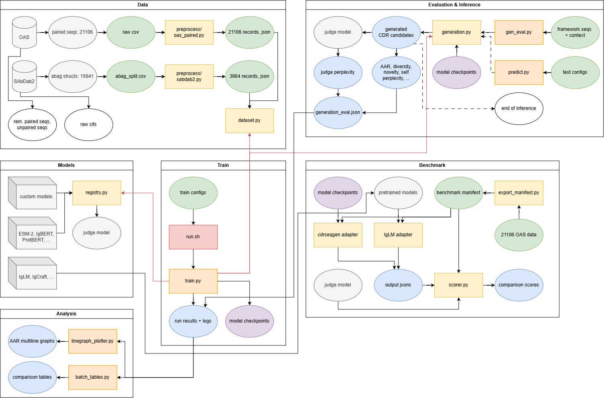

<!-- Note to AI: Edits allowed OUTSIDE of MANUAL PROTECTION ZONES and INSIDE of AI ACCESS ZONES -->
# CDRSeqGen: Modular Antibody Infilling Framework

**Date Updated:** 2026-08-17
**Status:** CDRSeqGen length-free validation complete; matched IgLM natural-EOS generation and scoring pending

## Project Overview
CDRSeqGen is a computational immunology framework designed to predict antibody loop sequences given the surrounding framework context. 

Current implemented features include: 
- **Data Preprocessing**: standardize data into Bio-Object JSON format (IMGT), current datasets: OAS (21106 paired sequences) and SAbDab2 (3984 paired + antigen structures)
- **Addressing Data Leakage**: clustered OAS splitting with optional train/validation/test partitions that keep clonal near-duplicates together
- **Task-Agnostic Masking**: masking training method for all 6 CDR loops individually by target selection
- **Pluggable Backbone PLMs**: supports various PLMs, current list: custom transformer (scratch), ESM-2, IgBert, ProtBert
- **Partner Chain Context**: optional inclusion of non-target chain sequence context
- **Antigen Context**: optional inclusion of antigen sequence context for SAbDab2 dataset
- **Context Dropout**: `context_dropout` trains one checkpoint that works with *and* without its optional context (partner chain / antigen drawn independently), instead of a model locked to the regime it was trained in
- **Generative Sampling**: independent / iterative (Mask-Predict) decoding with temperature (`0` = greedy), top-k, top-p — samples a *library* of candidate loops instead of one argmax guess
- **Explicit Length Policies**: fixed, bounded, and inferred-length MLM generation; inferred mode classifies one gap sentinel and expands it into residue masks without reading the native loop length
- **Evaluation Metrics**: *recovery-side* — Sequence Recovery Rate (Per-Residue Accuracy), anchor-excluded core accuracy, anchor accuracy. *Design-side* — diversity, novelty, per-position entropy, pseudo-perplexity, plus judge-scored perplexity for cross-model comparison
- **Matched External Benchmark**: versioned manifests, model-specific CDRSeqGen/IgLM adapters, shared contract validation and scoring, and optional independent-judge perplexity
- **Logging & Visualization**: per-run `train.log` (the whole run's record, including the generative-eval table and any uncaught traceback), TensorBoard logging, csv metric extraction, multi-line graph plotter
- **Extensible Architecture**: method packages isolate masked-LM assumptions so future autoregressive or encoder–decoder implementations can reuse shared data, metrics, artifacts, and benchmark contracts

---

## 🏗️ Repository Structure

```text
CDRSeqGen/
├── configs/                    # 48 run configs (flat; run.sh references them by path)
│   ├── h{1,2,3}_scratch[.json|_lc|_ag|_ag_lconly] + h{1,2,3}_esm2[...]
│   ├── h{1,2,3}_igbert[.json|_lc] + h{1,2,3}_protbert[.json|_lc]
│   └── l{1,2,3}_scratch[.json|_hc] + l{1,2,3}_esm2[.json|_hc]
├── cdrseqgen/                  # Library package — grouped by concern (entrypoints stay at root)
│   ├── artifacts.py            # Shared names for persisted run artifacts and legacy aliases
│   ├── data/                   # ALL data code (the data itself lives in dataset/data/)
│   │   ├── dataset.py          # Runtime: processed JSON → tensors (tokenizers, Dataset, collator)
│   │   └── preprocess/         # Offline: raw → processed JSON (run once per dataset)
│   │       ├── oas_paired.py       # OAS paired repertoires + the leakage-safe clustered split
│   │       ├── sabdab2.py          # SAbDab2 structures (adds antigen; split ships with the data)
│   │       ├── common.py           # Shared by both: validation, chain assembly, funnel, IO
│   │       ├── download_oas_paired.sh  # Fetch OAS paired repertoires → dataset/data/raw/
│   │       └── download_sabdab2.sh     # Fetch SAbDab2 splits → dataset/data/raw/ (CWD-independent)
│   ├── methods/                # Complete generation methods; no cross-method mask assumptions
│   │   └── mlm/                # Masked-LM training, generation, and native evaluation
│   │       ├── arguments.py        # MLM model/data/generation arguments + run setup
│   │       ├── backbones.py        # Masked-LM registry — resolve(model_type) -> Backbone
│   │       ├── training.py         # Datasets, Trainer lifecycle, post-training evaluation
│   │       ├── recovery.py         # Position recovery, anchor/core split, core coverage
│   │       ├── sampling.py         # Independent/iterative decoding + pseudo-perplexity
│   │       ├── evaluation.py       # Fixed-native generative evaluation
│   │       ├── variable_length_evaluation.py # Bounded/inferred held-out evaluation
│   │       ├── generation.py       # Length selection, mask expansion, decoder dispatch
│   │       ├── case_generation.py  # One framework -> candidates and metrics
│   │       ├── length.py           # Policies, constraints, evaluation-mode validation
│   │       ├── length_predictor.py # Gap-sentinel classifier + checkpoint artifacts
│   │       └── models/
│   │           └── transformer.py  # From-scratch masked encoder — model_type "scratch"
│   ├── train/                  # Method-neutral run logging and artifact reporting
│   │   ├── logging.py          # Logging, run dirs/latest, complete run_config.json
│   │   └── record_results.py   # epoch_metrics.csv + training-curve PNGs
│   ├── eval/
│   │   └── metrics.py          # Architecture-neutral sequence/design metrics
│   └── utils/
│       ├── linegraph_plotter.py  # Training-curve plotting utility
│       └── batch_tables.py       # Generates validated Markdown comparison tables from a batch
├── benchmark/                  # Frozen-manifest comparisons against external baselines
│   ├── adapters/               # CDRSeqGen and IgLM generation under one output contract
│   ├── manifests/              # Versioned validation/test inputs plus SHA-256 sidecars
│   ├── export_manifest.py      # Processed OAS split -> model-independent manifest
│   ├── scorer.py               # Shared validation, metrics, accounting, and judge scoring
│   ├── plot_comparison.py       # Matched recovery, length, position, and diversity dashboard
│   └── README.md               # End-to-end benchmark commands and protocol
├── dataset/data/               # THE DATA — gitignored, ~4.4GB (raw + processed OAS/SAbDab2).
│                               #   Deliberately outside the package; configs' data_path points here.
├── results/                    # Ignored in git. Always results/<batch>/<run>/ (two levels);
│                               #   results/latest -> newest batch dir.
├── test/                       # Unit tests plus curated qualitative JSON cases for generate.py
│   ├── test_*.py
│   └── test_{h1,h3,h3_lc,h3_ag}.json
├── misc/
│   └── CDRSeqGen260814.drawio.png  # Project workflow diagram
├── train.py                    # Entrypoint — masked-LM training
├── generate.py                 # Entrypoint — candidate generation on supplied frameworks
├── evaluate.py                 # Entrypoint — held-out generative evaluation (+ --judge)
├── fit_mlm_length.py           # Add MLM length artifacts to an older checkpoint
├── scripts/
│   ├── run.sh                  # Unified runner: ./scripts/run.sh <gpu> [oas|antigen|lcdr|igbert|protbert|plm|all ...]
│   ├── sweep_h3.sh             # Validation-safe, multi-seed H3 hyperparameter screen
│   └── sweep_scratch.sh        # Legacy 2026-07 pilot sweep (kept for provenance)
├── env.sh
└── README.md
```

---

## ⚙️ Environment Setup
This project uses Conda for strict CUDA handling and pip for Hugging Face tools.

1. Run the setup script:
   ```bash
   chmod +x env.sh
   ./env.sh
   ```
2. Activate the environment:
   ```bash
   conda activate cdrprj
   ```

---

## 🚀 Workflow & Execution

### Architecture Overview



> The diagram is the 2026-08-14 snapshot. It predates the `cdrseqgen/methods/mlm/` consolidation and
> the `generate.py` / `evaluate.py` / `fit_mlm_length.py` renames; a refreshed diagram is pending.

### Step 1: Preprocessing Data
Convert datasets into a custom "Bio-Object" JSON format, extracting the regions and preserving `ANARCI` numbering.

**OAS**: currently only including 21106 paired sequences from 1287169_1_Paired_All.csv, pending future scale-ups
```bash
python -m cdrseqgen.data.preprocess.oas_paired \
    --input_file dataset/data/raw/1287169_1_Paired_All.csv \
    --output_file dataset/data/processed/processed_oas_data.json
```

For hyperparameter tuning, create a separate three-way file. Test clusters are allocated first using
the historical shuffle, so the established test membership is preserved; validation is then taken
from the former training partition:
```bash
python -m cdrseqgen.data.preprocess.oas_paired \
    --input_file dataset/data/raw/1287169_1_Paired_All.csv \
    --output_file dataset/data/processed/processed_oas_tuning.json \
    --split cluster --test_size 0.1 --validation_size 0.1 --seed 42
```

**SAbDab2**: currently including 3984 structures - paired with resolved antigen, remaining >10k structures without antigen pending future inclusion
```bash
python -m cdrseqgen.data.preprocess.sabdab2 \
    --input_file dataset/data/raw/sabdab2/splits_final/abag_split.csv \
    --output_file dataset/data/processed/processed_sabdab2_data.json
```

Processed records preserve provenance needed by external baselines and future multi-source datasets:
`species`, both original IDs in `chain_sequence_ids`, and a stable `source` block (OAS run or
SAbDab/PDB identifiers). OAS species is read from its raw metadata row; the current SAbDab2 source
has an empty species column, so those records deliberately store `"species": null` rather than
assuming human. Each preprocessing run also writes a hash-verified `*.metadata.json` sidecar with
source details, filters, numbering convention, and split parameters.

### Step 2: Training & Batch Experimentation
We use `.json` configuration files to manage hyperparameters cleanly. The trainer calculates **Sequence Recovery Rate** (Per-Residue Accuracy), logs to TensorBoard, and auto-generates metric graphs at the end of every run.

**Run a Single Experiment:**
```bash
CUDA_VISIBLE_DEVICES=0 python train.py configs/h3_scratch.json
```

**Run an Automated Experiment Suite:** [`scripts/run.sh`](scripts/run.sh) takes a GPU id and one or more suite names, skips to the next config if one fails.
```bash
# One runner, suites chosen (and combined) by arg:  ./scripts/run.sh <gpu> [suite ...]
./scripts/run.sh 4                # default "all": OAS heavy + SAbDab2 antigen + OAS light (36)
./scripts/run.sh 4 oas            # OAS heavy matrix, scratch+ESM-2 (h1/h2/h3)          (12)
./scripts/run.sh 4 antigen        # SAbDab2 heavy antigen matrix (_ag / _ag_lconly)     (12)
./scripts/run.sh 4 lcdr           # OAS light matrix (l1/l2/l3, heavy-chain context)    (12)
./scripts/run.sh 4 oas lcdr       # combine suites — deduped, run in order              (24)

# Antibody/protein-BERT PLM backbones on OAS heavy (first run downloads a ~1.6GB model each)
./scripts/run.sh 4 igbert         # IgBert (antibody-specific)                           (6)
./scripts/run.sh 4 protbert       # ProtBert (general-protein baseline)                  (6)
./scripts/run.sh 4 plm            # both (igbert + protbert)                            (12)
```

**Every run lives at `results/<batch>/<run>/` — always two levels.** A `run.sh` round shares one batch
folder; a standalone `train.py` gets a batch folder of its own, so `results/` never collects loose run
dirs. **`results/latest`** is a symlink to the most recent *batch*, so `results/latest/<config>/`
addresses any run in that round:

```text
results/
├── 20260720_191138/                    ← one ./scripts/run.sh round
│   ├── h1_OAS_scratch/
│   └── h3_OAS_LC_scratch/
├── 20260720_193002/                    ← a single train.py run
│   └── h3_OAS_scratch/
├── sweeps/h3_20260811_193030/          ← validation-safe sweep; results/latest unchanged
│   ├── h3_OAS_scratch_lr1e-4_wu0.0_wd0.0_s42/
│   └── h3_OAS_scratch_lr1e-3_wu0.06_wd0.01_s43/
└── latest -> 20260720_193002/          ← newest batch; generate.py uses latest/<config>
```

The run folder is named from the **resolved arguments**, not the config filename — `h3_scratch.json
--target_region l3` produces an `l3_OAS_HC_scratch` folder, so an override can't be misfiled. The
date/time lives on the batch folder and isn't repeated inside.

**Tag a run** with `CDRSEQGEN_RUN_SUFFIX` to distinguish runs that resolve to the same name:
```bash
CDRSEQGEN_RUN_SUFFIX=ablation_noLC python train.py configs/h3_scratch.json
#  -> results/<batch>/h3_OAS_scratch_ablation_noLC/
```
`sweep_h3.sh` tags every trial with its LR, warm-up, weight decay, and seed, so folders are
self-describing. It groups trials with `CDRSEQGEN_RESULTS_ROOT`, writes `runs.tsv`/`summary.tsv`, and
sets `CDRSEQGEN_SKIP_LATEST=1` so exploratory trials do not replace the main usable batch. If two runs
still collide, the second becomes `..._2` with a logged warning; a run never silently overwrites another.

A standalone `python train.py …` sets neither environment variable and retains the normal behavior.
Export `CDRSEQGEN_RESULTS_ROOT` yourself to group manual runs:
```bash
CDRSEQGEN_RESULTS_ROOT=results/my_experiment python train.py configs/h3_scratch.json
```

**Override a config from the CLI:** trailing flags override the JSON (they do **not** replace it), so any
`TrainingArguments` field is tunable without writing a new config:
```bash
python train.py configs/h3_scratch.json --learning_rate 3e-4 --num_train_epochs 20 --warmup_ratio 0.06
```

The original `masking_policy: "full_span"` remains the default: every native CDR residue is replaced
by its own mask token. Opt into mixed-mask training when training a checkpoint for iterative
decoding:

```bash
python train.py configs/h3_scratch.json \
    --masking_policy mixed --mixed_full_span_probability 0.5
```

Mixed mode keeps the requested fraction of training examples fully masked. For every other example,
it reveals at least one native loop residue and masks at least one, with loss computed only over the
masked subset. Validation, post-training generation, and standalone evaluation always use a separate
`full_span` dataset view, so partially revealed native residues cannot leak into reported recovery.
Both settings are persisted in `run_config.json`.

**Tune H3 on validation:** [`scripts/sweep_h3.sh`](scripts/sweep_h3.sh) runs a validation-only,
multi-seed screen. Its default 32 trials cover 4 learning rates × 2 warm-up ratios × 2 weight decays ×
2 seeds. Every trial shares a fixed 30-epoch linear-scheduler horizon and uses early stopping; epoch
budget is deliberately not swept because it would also reshape the scheduler. Post-training generative
evaluation is disabled during tuning.
```bash
./scripts/sweep_h3.sh 4
SEEDS="42 43 44" LRS="3e-4 1e-3" ./scripts/sweep_h3.sh 4
```
The script refuses datasets without explicit `train`/`validation`/`test` labels, ranks settings by
mean best validation core recovery across seeds, writes `runs.tsv` and `summary.tsv`, never selects
the test partition, and leaves `results/latest` untouched. Set `SWEEP_DIR` to resume. The older
[`sweep_scratch.sh`](scripts/sweep_scratch.sh) is retained only as provenance for the July pilot; it
selected among trials on the final holdout and should not be used for the IgLM comparison.

**Completed screen (2026-08-11).** All 32 trials completed on the three-way clustered OAS split
(16 settings × seeds 42/43). The leading region was shallow rather than decisive:

| LR | warm-up | weight decay | mean validation core recovery | seed SD | mean best epoch |
|---:|---:|---:|---:|---:|---:|
| **1e-3** | **0.06** | **0.01** | **0.32305** | 0.00138 | 16.5 |
| 3e-4 | 0.06 | 0.01 | 0.32269 | 0.00070 | 18.5 |
| 3e-4 | 0.00 | 0.00 | 0.32238 | 0.00032 | 13.5 |

The top-two gap is only 0.00036 and changes sign between the two seeds, so this screen identifies a
region, not a conclusive winner. Confirm the top two with additional shared seeds before freezing a
training config; evaluate the final choice only once on `test`. Full local records are in
`results/sweeps/h3_20260811_181946/{runs,summary}.tsv`.

### Step 3: Result Visualization & Comparison
All three recovery metrics are recorded **every epoch** (`compute_metrics` → `epoch_metrics.csv`:
`eval_accuracy`, `eval_core_accuracy`, `eval_anchor_accuracy`), and each run auto-generates four PNGs:

| file | shows |
|---|---|
| `eval_loss_curve.png` | loss |
| `eval_accuracy_curve.png` | whole-span recovery (anchor-inflated) |
| `eval_core_accuracy_curve.png` | **core** recovery — the one to report |
| `recovery_breakdown.png` | all three together — the anchor gap at a glance (H3: ~0.46 / ~0.32 / ~0.90) |

Use the **breakdown** chart to see the anchor gap, and the **individual** charts to read a trend: the
breakdown's y-axis spans ~0.3–0.9, which compresses within-line movement (ESM-2's core decay from
0.321 → 0.306 is legible on `eval_core_accuracy_curve.png`, barely visible on the breakdown).

One function draws both comparison shapes, because every line is the same triple `(run_dir, column, label)`.
Each `--run` takes `LABEL FOLDER [METRIC]`; omit `METRIC` and it falls back to the global `--metric`
(default `eval_core_accuracy`):

```bash
# same metric across runs — metric named once
python -m cdrseqgen.utils.linegraph_plotter \
  --metric eval_core_accuracy \
  --run "H3 Scratch" "results/20260729_202635/h3_OAS_scratch" \
  --run "H3 ESM-2"   "results/20260729_202635/h3_OAS_esm2_t12_35M_UR50D" \
  --title "H3 Core Recovery: Scratch vs ESM-2"

# breakdown of ONE run — per-run metric, several columns on one chart
python -m cdrseqgen.utils.linegraph_plotter \
  --run whole  "results/latest/h3_OAS_scratch" eval_accuracy \
  --run core   "results/latest/h3_OAS_scratch" eval_core_accuracy \
  --run anchor "results/latest/h3_OAS_scratch" eval_anchor_accuracy \
  --ylabel Recovery --title "H3 whole vs core vs anchor"
```

A missing CSV or column is reported and skipped rather than aborting the chart, so one bad path in a
multi-run comparison doesn't lose the other lines. Charts default to `results/pngs/`.

<!-- > **⚠️ Never mix datasets on one chart.** OAS (`_OAS`) and SAbDab2 (`_SD2`) runs are evaluated on *different test sets*, so their accuracies are not comparable on shared axes — plot one graph per dataset (e.g. `cdr3_oas` with the 4 OAS runs, `cdr3_sd2` with the 4 SAbDab2 runs). The `results/comparisons/*_oas_*.png` / `*_sd2_*.png` pairs follow this convention. -->

### Step 4: Qualitative Sampling on Curated Frameworks (`generate.py`)
Give it a framework with its CDR loop cut out (`pt1` / gap / `pt2`) and it fills the gap: samples a
library of candidate loops (default **iterative**) and prints them, each with recovery-vs-native (when
you provide the native) and pseudo-perplexity, plus per-framework diversity/novelty. It also reports
which CDR the checkpoint was trained for (read from `run_config.json`). Samples + metrics are written to
`<model_path>/generation_results.json`.

> **This is a showcase, not an evaluation.** `test/*.json` holds only a handful of curated frameworks
> (mostly without natives). For numbers you can report, use **Step 5**, which draws real held-out
> frameworks straight from the eval split.

> **⚠️ Match the checkpoint's context, or the model silently underperforms.** A checkpoint trained with
> partner-chain or antigen context does not *fail* on a bare framework — the input is merely
> out-of-distribution, so it quietly produces bad loops. Measured on `h1_OAS_LC_scratch`, 60 held-out
> frameworks, greedy: **0.9858** recovery with the light chain supplied as trained, **0.2599** without.
> In the latest batch **24 of 36 checkpoints** need context.
>
> Pass it with `--partner_chain` / `--antigen` (or per-case `partner_chain` / `antigen` keys in a
> `--test_file`), and set `--max_len` to the training config's value (512 for the SAbDab2 antigen runs).
> `generate.py` reads `run_config.json`, prints what the checkpoint expects, and **refuses** a context
> mismatch in either direction unless `--force` — supplying context a model never saw is as damaging
> as withholding context it needs (0.308 → **0.000** on `h3_OAS_scratch` with a partner chain
> prepended), because for an absolute-position backbone it shifts every learned position. Injection
> goes through the same `inject_context` / `assemble_masked_input` that build the training examples,
> so which side the antigen lands on — and which side gets truncated — follows the backbone's
> `position_type` automatically instead of being hand-encoded in the test file.
>
> The **loop** is a weaker signal and is treated accordingly. Nothing in the tensor names a loop or a
> chain, so which CDR you are designing is fixed by which checkpoint you load; `--target_loop` only
> *declares* your intent and cannot change the computation, so a mismatch **warns** rather than
> refuses — the input is still well-formed, just answered by weights fitted for another loop, which
> is a legitimate thing to probe. Because that check is opt-in, one more runs unconditionally: the
> length of `pt1` says where along the chain the gap sits, and across all 50,180 frameworks in both
> processed datasets the three CDR numbers separate cleanly (CDR1 8–26, CDR2 33–57, CDR3 78–106).
> That catches an h3 checkpoint fed an H1 framework with nothing declared, which was previously
> silent. Only the **number** is inferable — H1 (23–25) and L1 (24–26) overlap outright — so a
> heavy/light mix-up still cannot be detected this way.

```bash
# design coherent loops for a batch of curated frameworks (default: iterative sampling)
# results/latest is the newest batch — name the config under it (here: h3_OAS_scratch)
python generate.py --model_path ./results/latest/h3_OAS_scratch --test_file test/test_h3.json --use_native_length

# more candidates + nucleus sampling
python generate.py --model_path ./results/latest/h3_OAS_scratch --test_file test/test_h3.json \
    --use_native_length --decoding iterative --num_samples 50 --top_p 0.9

# a single framework straight from the CLI (equal bounds mean an exact length)
python generate.py --model_path ./results/latest/h3_OAS_scratch --pt1 EVQL...YYCAR --pt2 WGQGT... \
    --min_length 17 --max_length 17

# constrain each sampled length to an inclusive range (one-sided bounds also work)
python generate.py --model_path ./results/latest/h3_OAS_scratch --pt1 EVQL...YYCAR --pt2 WGQGT... \
    --min_length 11 --max_length 15 --num_samples 50

# infer length from the framework: omit target_length/min_length/max_length
python generate.py --model_path ./results/latest/h3_OAS_scratch --pt1 EVQL...YYCAR --pt2 WGQGT... \
    --num_samples 50
```

Length selection passes through one explicit policy layer. Equal bounds request an exact fixed
length; unequal or one-sided bounds truncate and renormalize the checkpoint's learned length
distribution; omitted bounds sample that distribution without consulting the native target. A
`target_truth` is scoring-only unless `--use_native_length` is passed explicitly, preventing silent
length leakage. `--target_length` remains as a deprecated fixed-length alias. Every result stores the
policy, bounds, constrained probabilities, selected lengths, and prompt truncation under
`length_policy`.

The sequence backbone is still an encoder-only MLM: one **gap sentinel** is classified into a length,
then expanded into that many residue masks before the existing decoder runs. New training runs fit
and save `length_config.json` plus `length_head.safetensors` beside the best sequence checkpoint by
default; the sequence weights remain frozen during this fit. For a checkpoint trained before these
artifacts existed, run:

```bash
python fit_mlm_length.py --model_dir results/path/to/old_run
```

This discovers the run's saved `run_config.json`, keeping the original processed dataset and split.
Use `--config path/to/config.json` only when the checkpoint has no saved run configuration.
Inspect the resulting `length_config.json` before generation: its held-out `eval_accuracy` and
`eval_length_mae` should improve on `eval_mode_baseline_accuracy` and
`eval_mode_baseline_length_mae`; otherwise the head is mostly reproducing the training-set mode.

> **First result (2026-08-17): the mechanism works, but this length head does not yet beat the naive
> baseline.** On the full 2,111-framework validation split, the tuned scratch checkpoint's head
> reached 9.24% exact-length accuracy and 3.64 MAE, versus 10.52% and 3.28 for always predicting the
> training mode (length 15). See Finding §10; this is an open modeling result, not a software failure.

`--decoding`: `independent` (per-position sampling, 1 forward pass) · `iterative` (confidence-ordered
Mask-Predict — conditions each residue on those already committed). **`--temperature 0` makes either
deterministic (greedy)** and returns a single loop. Warp with `--temperature` / `--top_k` / `--top_p`;
`--skip_perplexity` drops the compute-heavy scoring.

> **⚠️ The two decoders are currently equivalent — use `independent` for sweeps.** Measured 2026-07-28
> on `h3_OAS_esm2`, 150 stratified frameworks, 20 samples, `top_p 0.9`, seed 42, IgBert judge:
>
> | metric | iterative | independent | Δ |
> |---|---|---|---|
> | recovery | 0.4057 | 0.4072 | +0.0015 |
> | diversity | 0.5731 | 0.5703 | −0.0028 |
> | entropy (bits) | 1.8414 | 1.8242 | −0.0171 |
> | judge-ppl | 7.1434 | 7.2259 | +0.0825 |
>
> Every difference is within noise, while iterative costs **~15×** the forward passes (one per masked
> position; mean H3 length 15.1). Mask-Predict only helps when the loop joint differs from the product
> of per-position marginals — getting identical numbers says this masked-LM has learned near-independent
> marginals for H3. That is a limit of the **training objective**, not of the sampler, and it is direct
> evidence for the "marginal-based, not learned-joint" open problem below.

### Step 5: Generative Evaluation on the Held-Out Split (`evaluate.py`)
The reportable version of Step 4. Reconstructs the **exact training-time eval split** from the config
(same clustered leakage-safe holdout, same partner/antigen injection, a real native on *every*
framework — 2,111 held-out antibodies for OAS), samples `--num_samples` candidates each, and aggregates
the generative metrics — overall **and bucketed by H3 length**, since difficulty scales with it.

```bash
python evaluate.py \
    --config configs/h3_esm2.json \
    --model_dir results/20260710/20260710_184547_h3_OAS_esm2_t12_35M_UR50D \
    --num_examples 150 --stratify --num_samples 20 \
    --decoding iterative --top_p 0.9 \
    --judge Exscientia/IgBert
```

The command above is the original `fixed_native` track. Use the checkpoint length head for a bounded
or fully inferred sweep:

```bash
# inclusive range; either min or max may be omitted
python evaluate.py --config configs/h3_esm2.json --model_dir results/path/to/run \
    --length_mode bounded --min_length 11 --max_length 15 --num_samples 20

# no native mask count is supplied to generation
python evaluate.py --config configs/h3_esm2.json --model_dir results/path/to/run \
    --length_mode inferred --num_samples 20
```

Positional AAR/core/anchor recovery is calculated only for candidates whose generated length matches
the native loop. All valid candidates still contribute to length-match rate, length MAE,
alignment-aware edit similarity, diversity, validity, runtime, and judge perplexity.

> **⚠️ Self-perplexity is NOT comparable across models.** Pseudo-perplexity is scored under each model's
> *own* distribution, so it measures self-consistency — a model confident in its own outputs looks good
> regardless of quality. To compare models, pass `--judge <model_type>`: every candidate is then also
> scored by one **independent** reference LM (IgBert is a good pick — antibody-specific, and independent
> of both scratch and ESM-2). Diversity/entropy carry no such caveat; they're purely sequence-based.

`--num_examples K` subsamples the split (`-1` = all; default 200); `--stratify` balances the draw across
short/medium/long H3 buckets so rare long loops aren't washed out. Results land in
`<model_dir>/generation_eval.json`.

#### Generative evaluation runs automatically after every training run
Once all epochs finish, `train.py` fits the frozen-backbone length head, samples designs from the
finished best model, and writes `generation_eval.json` beside `epoch_metrics.csv`. Both the length
fit and fixed-native generative evaluation are **on by default** — no config change is needed.

It samples from **`trainer.model`** (with `load_best_model_at_end` that's the peak checkpoint, already
on the GPU, so nothing is reloaded from disk), runs last, and is exception-guarded: a generation
failure logs a warning and **cannot** damage a training run that already finished and saved.

Every candidate is also scored by an **independent judge** (`gen_judge`, default
`Exscientia/IgBert`), which is what makes perplexity comparable *across* runs — self-perplexity is
not. Comparability requires the same judge in every run, **not** the same process, so per-run
judging is valid. Tune or disable via config:

```json
"run_generative_eval": true,
"gen_num_examples": 150,
"gen_num_samples": 20,
"gen_decoding": "iterative",
"gen_top_p": 0.9,
"gen_length_mode": "fixed_native",
"gen_min_length": null,
"gen_max_length": null,
"gen_length_temperature": 1.0
```

Set `run_generative_eval: false` (or `gen_judge: ""` to keep the metrics but skip the judge) to opt out;
trim `gen_num_examples` for cheap runs. Cost is ~80s of sampling + ~15s to load the judge per run.

Both evaluation paths share the MLM evaluation implementation
([`cdrseqgen/methods/mlm/evaluation.py`](cdrseqgen/methods/mlm/evaluation.py)); they differ only in
where the model comes from. Length policy, checkpoint-specific classification, mask expansion, and
independent-versus-iterative decoder dispatch live in
[`cdrseqgen/methods/mlm/`](cdrseqgen/methods/mlm/). Future autoregressive and encoder-decoder methods
can be added beside `mlm/` without inheriting its mask-token, pseudo-perplexity, or length-expansion
assumptions. The MLM primitives are shared by `generate.py`, both held-out evaluation paths, and the
CDRSeqGen benchmark adapter, so the callers cannot silently use different variable-length behavior.
`evaluate.py` stays the tool of choice for
scoring checkpoints you already trained, or re-sweeping temperature / top-p / judge without
retraining.

### Matched External Benchmark

The frozen-manifest CDRSeqGen–IgLM validation and final-test workflow is documented in
[`benchmark/README.md`](benchmark/README.md). Generation remains model-specific in the two adapters;
[`benchmark/scorer.py`](benchmark/scorer.py) validates the matched contract and applies one shared
metric implementation. Validation-smoke results are development checks, not final benchmark claims.

Current length-free status (2026-08-17): the tuned scratch adapter completed all 25 validation
frameworks × 20 candidates with zero failures and a 6.0% sampled native-length match rate. IgLM's
matched natural-EOS output, shared scoring, and the comparison plot are still pending; therefore no
length-free CDRSeqGen-versus-IgLM claim exists yet.

---

## 📊 Findings

Phase 1 (the sequence sweep) is a **leakage-safe benchmark** for CDR infilling. What it establishes:

*Numbers below are from the complete 36-run batch `results/20260729_202635` (6 loops × {scratch, ESM-2} ×
context × {OAS, SAbDab2}), read at **best epoch** under the coverage-aware recovery policy below.
Every generated table states the selected metric and minimum core coverage. Budgets are per family —
20 epochs for scratch, 10 for pretrained, both with `early_stopping_patience: 3`.*

> **⚠️ These numbers supersede the 07-24 batch, which trained every family for exactly 10 epochs.**
> That budget under-trained the scratch model, and it inflated the magnitude of **four** findings at
> once — §1, §2, §4 and §7 — all in the same direction, against the smaller model. See §9.

> **Every table here is generated, not hand-written** — regenerate them all after any new batch with:
> ```bash
> python -m cdrseqgen.utils.batch_tables --batch results/20260729_202635
> python -m cdrseqgen.utils.batch_tables --only regimes,loops   # or a subset
> ```
> It reads only what a finished run already writes (`epoch_metrics.csv`, `generation_eval.json`,
> `run_config.json`) plus the processed dataset JSONs, and prints markdown ready to paste. The one
> exception is the decoding table (Step 4), which needs two `evaluate.py` runs differing only in
> `--decoding`, passed via `--decoding-json` (the pair used above is kept alongside that run as
> `generation_eval_decoding_{iterative,independent}.json`).

**1. "Model choice doesn't matter" is only true in two of three regimes.** On OAS H3 a 128-dim from-scratch transformer matches ESM-2 (0.3148 vs 0.3209 core). But that generalises badly — whether pretraining pays depends entirely on how much of the test set is *memorisable* from train (see §6):

| case | unseen in train | metric | min core coverage | scratch | ESM-2 | Δ |
|---|---|---|---:|---:|---:|---:|
| OAS H1 | 1.6% | core | 100.0% | 0.9930 | 0.9935 | **+0.000** |
| SD2 H1 | 57.5% | core | 100.0% | 0.5473 | 0.6664 | **+0.119** |
| SD2 H2 | 79.6% | core | 100.0% | 0.3672 | 0.6083 | **+0.241** |
| OAS H3 | 100.0% | core | 100.0% | 0.3185 | 0.3209 | **+0.002** |

Pretraining buys ~nothing when the answer can be looked up, **+0.12–0.24** when the task needs genuine generalisation, and ~nothing again at the H3 ceiling. The original claim was drawn from regimes 1 and 3 only.

**2. CDR-H3 is the only hard loop — but the other five are easier than they look.** Best-epoch recovery on OAS under the recorded core-coverage policy:

| CDR | reported metric | min core coverage | scratch | +ctx | ESM-2 | +ctx |
|---|---|---:|---:|---:|---:|---:|
| H1 | core | 100.0% | 0.9930 | 0.9893 | 0.9935 | 0.9933 |
| H2 | core | 100.0% | 0.9897 | 0.9802 | 0.9899 | 0.9903 |
| **H3** | core | 100.0% | **0.3185** | 0.3139 | **0.3209** | **0.3243** |
| L1 | core | 100.0% | 0.9925 | 0.9841 | 0.9938 | 0.9937 |
| L2 | whole | 1.4% | 0.9927 | 0.9819 | 0.9932 | 0.9927 |
| L3 | core | 99.9% | 0.9261 | 0.9019 | 0.9274 | 0.9262 |

The biology is right — heavy CDR3 gets D-gene + junctional diversity, the rest is germline-templated — but the ~0.99s are **not** evidence the model generalises; under the current split they are largely retrieval (§6). Only H3 is measured on entirely unseen loops.

**3. The standard metric misleads (anchor inflation).** Whole-span `eval_accuracy` (~0.46 on H3) is dominated by the 2-3 V/J-gene-determined anchor residues at each loop end (~0.90 recovery, any model); the hypervariable middle actually being "designed" is ~0.32. The gap is **H3-specific** (H1/H2/L core ≈ whole-span). Measured via `core_accuracy`/`anchor_accuracy` ([`compute_metrics`](cdrseqgen/eval/recovery.py), passed to the Trainer by `train.py`); the position-resolved breakdown below is from the standalone re-scorer `eval_recovery.py` (archived in `old/`). Illustrative (`h3_esm2`):

| Position from start | 0 | 1 | 2 | 3 | 4 | 5 |
|---|---|---|---|---|---|---|
| Accuracy | 100% | 89% | 35% | 21% | 20% | 14% |

**4. Sequence context — partner chain and antigen — gives no measurable benefit.** The valid same-data antigen ablation (`_ag` vs `_ag_lconly`, SAbDab2, all 3 CDRs) shows no signal, and it *survives the core metric*:

| CDR | metric | min core coverage | scratch lc-only → +ag | ESM-2 lc-only → +ag |
|---|---|---:|---|---|
| H1 | core | 100.0% | 0.5473 → 0.4834 | 0.6664 → 0.6629 |
| H2 | core | 100.0% | 0.3672 → 0.3486 | 0.6083 → 0.5894 |
| H3 | core | 99.7% | 0.1308 → 0.1352 | 0.2214 → 0.2128 |

|Δ| ≤ 0.064, sign inconsistent, 5 of 6 comparisons negative. Not a truncation artifact (84% of complexes keep the full antigen at `max_len=512`).

**Partner-chain context: the earlier "it hurts the small model" claim was mostly an under-training artifact.** At a 10-epoch budget it looked like a solid effect; at 20 epochs two thirds of it disappears:

| loop | Δ at 10 epochs | Δ at 20 epochs |
|---|---|---|
| H1 | −0.0103 | −0.0038 |
| H2 | −0.0279 | −0.0095 |
| H3 | −0.0086 | −0.0046 |
| L1 | −0.0277 | −0.0084 |
| L2 | −0.0331 | −0.0108 |
| L3 | **−0.0786** | −0.0242 |
| **mean** | **−0.0310** | **−0.0102** |

Adding context lengthens the input and slows convergence: every `+ctx` scratch run peaked at **epoch 18–20**, against 4–14 without it, and five were still improving when the budget ran out — so −0.0102 is an *upper* bound. ESM-2 is unmoved either way (−0.001 to +0.003).

**With an error bar (finally).** Three seeds of `h3_scratch` ± partner chain, 20-epoch budget:

| seed | no ctx | +LC | Δ |
|---|---|---|---|
| 1 | 0.3196 | 0.3154 | −0.0042 |
| 2 | 0.3199 | 0.3123 | −0.0076 |
| 3 | 0.3187 | 0.3089 | −0.0098 |
| | sd **0.0006** | sd **0.0033** | mean −0.0072, sd **0.0028** |

The effect is real but small (2.5σ, all three seeds negative), and the noise floor on a per-loop Δ is **σ ≈ 0.0028**, i.e. ~0.006 at 2σ. Applying that to the table above, only four of the six loops survive:

| loop | Δ | |Δ|/σ | |
|---|---|---|---|
| H2 / L1 / L2 / L3 | −0.0084 … −0.0242 | 3.0 – 8.6 | real |
| **H1 (−0.0038), H3 (−0.0046)** | | **1.4 / 1.6** | **not distinguishable from noise** |

So on the loop that actually matters — H3 — partner-chain context has **no measurable effect in either direction**, and the earlier −0.0086 was noise plus under-training. A second observation from the same three seeds: the `+ctx` runs are **5× more variable** than the base runs (sd 0.0033 vs 0.0006) and their best epoch swings between 10 and 20, so context destabilises training as well as slowing it.

**Interpretation is unchanged:** sequence context — partner chain or antigen — buys nothing measurable. Binding information is geometric, not linear-sequence, so the next lever is structure / cross-attention. What changed is that the apparent *harm* was largely our own budget.

**5. The homology leak was real but immaterial *for H3*.** OAS's original random split leaked clonal near-duplicates (76 of 2,111 test entries, 3.6%, share a CDR3 cluster with train). The clustered-split fix removed it (→0%), and re-running confirmed the H3 core moved by **≤0.004**. (Now the default; see [`preprocess/oas_paired.py`](cdrseqgen/data/preprocess/oas_paired.py).) The important qualifier is *for H3* — the split clusters on heavy CDR3 only, so it controls nothing for the other five loops (§6).

**6. The clustered split controls H3 and nothing else — so the ~0.99s are retrieval.** `cluster_by_cdr3` groups on heavy CDR3, and whole clusters are held out. Two antibodies with identical H1/H2 land on opposite sides freely as long as their CDR3s differ:

| | unique H1 strings | test entries with an **unseen** H1 | test entries with an unseen H2 | recovery |
|---|---|---|---|---|
| OAS | 439 / 21,106 (2.1%) | 33 / 2,111 (**1.6%**) | 42 / 2,111 (2.0%) | ~0.99 |
| SAbDab2 | 895 / 3,984 (22.5%) | 431 / 750 (**57.5%**) | 597 / 750 (79.6%) | 0.33–0.43 |

98% of OAS test H1s appear verbatim in training, so H1/H2/L1/L2/L3 under this split are near-lookup tasks — which is why every model scores ~0.99 and why context and pretraining make no difference there. **SAbDab2 is not underperforming; it is the only place the non-H3 loops are honestly measured.** H3 is unaffected (100% of test H3s are unseen by construction). Fixing this needs a per-loop split — cluster on whichever CDR is the target — which is a contained change to `add_split_field`.

**7. Recovery and design quality disagree — high AAR can mean a perfect copier.** From the post-training generative eval (150 held-out frameworks, 20 samples each, IgBert judge):

| | recovery | diversity | entropy (bits) | judge-ppl |
|---|---|---|---|---|
| H1 scratch | 0.991 | 0.005 | 0.010 | 1.06 |
| H1 ESM-2 | 0.991 | **0.002** | **0.004** | 1.05 |
| H3 scratch | 0.405 | 0.569 | 1.836 | 7.22 |
| H3 ESM-2 | 0.407 | 0.570 | 1.824 | 7.23 |

H1 scores 0.99 AAR while emitting essentially **one** sequence with total certainty (perplexity ≈ 1.0) — a perfect copier and a useless designer. And on H3 the two metrics rank the models differently: recovery calls scratch and ESM-2 near-equal, the independent judge puts ESM-2 **1.7× ahead**. Recovery alone is insufficient to choose a model, which is the practical argument for a design-aligned objective.

**8. A model is locked to the context regime it was trained in — and `context_dropout` unlocks it.** Feeding a checkpoint the *wrong* amount of context is as damaging as feeding it none, in both directions, because for an absolute-position backbone a prepended partner chain shifts every learned position:

| H1 / OAS / scratch | eval WITH ctx | eval WITHOUT |
|---|---|---|
| trained WITHOUT ctx | **0.1588** | 0.9969 |
| trained WITH ctx | 0.9837 | **0.2612** |
| `context_dropout=0.5` | 0.9791 | 0.9931 |

Training a fraction of examples context-free (each context kind drawn independently, deterministic per example) buys one checkpoint that holds up in every regime. Worst-case recovery, 80 held-out frameworks, greedy:

| | specialist, own regime | specialist, wrong regime | `context_dropout=0.5`, worst |
|---|---|---|---|
| OAS H1 | 0.9969 | 0.1588 | **0.9791** |
| OAS H3 | 0.4353 | 0.0535 | **0.4244** |
| SAbDab2 H3 | 0.2271 | 0.1217 | **0.1766** |

**On OAS it is nearly free** (−0.011 to −0.018 against the best specialist, for a ~6× better worst case). **On SAbDab2 it is not** (−0.051): with 3,234 training entries, splitting across four context combinations leaves ~800 per regime, and the model ends up preferring the *no-context* input (0.2384) over the one it was configured for (0.1832). Read that as a data-size limit, not a refutation — dropout costs what the dataset can't afford to split.

Two side benefits on the datasets where it is cheap: the partner-chain and antigen ablations become *within-model* comparisons (same weights, two inputs) instead of comparisons between separately-trained runs with different init and SGD paths; and it removes the silent-degradation failure `generate.py` has to warn about.

**9. One un-audited hyperparameter inflated four findings at once.** Every config trained for exactly `num_train_epochs: 10`, which suited the pretrained models (ESM-2 median best epoch **4**) and starved the scratch model (median **9**, with 8/18 still improving at the cut-off). Re-running with per-family budgets — 20 epochs for scratch, 10 for pretrained, both with `early_stopping_patience: 3` — moved four separate results, all in the same direction:

| finding | at 10 epochs | at per-family budgets |
|---|---|---|
| §1 pretraining lead, SD2 H1 | +0.231 | **+0.119** |
| §4 partner-chain penalty (mean) | −0.0310 | **−0.0102** |
| §7 judge-ppl gap, H3 scratch vs ESM-2 | 1.74× | **1.00×** |
| §2 scratch `+ctx` recovery | — | +0.007 to +0.055 |

The §7 change is the starkest: scratch's judge-perplexity went **12.42 → 7.22** against ESM-2's 7.23. Recovery and the judge no longer disagree; they were only disagreeing because one model was under-trained. (Not the decoder switch — iterative and independent were measured equivalent, and ESM-2's number barely moved.)

Early stopping cost nothing on the pretrained side — mean Δ over 12 OAS runs was **−0.0000**, and zero runs were cut with their best at the final epoch — while shortening the batch from 295 to 226 minutes.

**The lesson is procedural:** a single budget shared across model families is not a neutral choice, and every distortion it caused ran against the smaller model. Anything compared across families should have its budget justified per family, or the comparison measures the budget.

**10. Removing native H3 length exposes a separate unsolved problem.** The first length-free run used
the validation-selected scratch checkpoint (`1e-3` learning rate, 0.06 warm-up, 0.01 weight decay,
seed 42). Its frozen sequence backbone supplied the representation for a gap-sentinel length
classifier; neither fitting nor generation received the native length.

| length result | learned head | mode baseline (always 15) |
|---|---:|---:|
| exact accuracy, 2,111 validation frameworks | **9.24%** | 10.52% |
| mean absolute error | **3.64** | 3.28 |

The downstream adapter then produced 500/500 syntactically valid candidates on the frozen
25-framework length-free validation manifest, with zero failures and **30/500 (6.0%)** native-length
matches. That 6.0% is a sampled-candidate rate on a small manifest, whereas the table reports one
argmax decision per example over the full validation split, so they should not be equated.

This is a useful negative result: the current representation/head does not extract more length
information from the framework than a trivial global guess. It does **not** yet quantify the effect
on sequence quality or establish an IgLM comparison—the matched IgLM natural-EOS run and shared
scoring remain pending. Fixed-native and length-free results must therefore remain separate tracks.

> **Bottom line:** fixed-native sequence-only CDR-H3 infilling saturates at ~0.32 core / ~0.46
> whole-span regardless of model, context, dataset, or decoder; length inference is not solved by the
> first gap-sentinel head; and the non-H3 loops are not yet measured on a split that tests
> generalisation. Together these motivate both the matched IgLM audit and the eventual shift to a
> **structure objective** (see Roadmap).

---

## 🧠 Architectural Feature Details

### 1. Task-Agnostic Masking (The "LEGO" Principle)
The `AntibodyInfillingDataset` separates sequences into `pt1` (left context), `mask` (target gap), and `pt2` (right context). The `target_region` string alone chooses the loop — `h1/h2/h3` mask a heavy CDR, `l1/l2/l3` mask the *light* chain's CDR (legacy `cdr*`/`lcdr*` spellings still parse). Switching target requires changing zero core tokenization logic. Labels are strictly length-enforced to prevent cross-entropy dimension mismatches.

### 2. Pluggable Backbones (the extensibility core)
The masked-LM backbone registry [`backbones.py`](cdrseqgen/methods/mlm/backbones.py) holds one `Backbone` entry per compatible model family; the entrypoints and `dataset.py` never branch on model type — they go through `resolve(model_type)`, which returns the matching backbone and a uniform `TokenizerAdapter`. The same MLM pipeline trains the from-scratch transformer, fine-tunes ESM-2, or fine-tunes any Hugging Face masked-LM just by changing the `"model_type"` string.

Each backbone declares two conventions **explicitly** instead of letting them be guessed from the tokenizer (the previous code overloaded a single `is_esm` boolean to mean three different things, which silently mishandled non-ESM models):
- **`position_type`** (`"absolute"` | `"relative"`) — controls where antigen context is injected (see §4). Absolute-position models (the scratch transformer, BERT-style protein LMs) need it appended after the target; relative/rotary models (ESM-2) can take it prepended.
- **`uses_special_tokens`** — whether inputs are wrapped as `[cls] … [end]`. The `TokenizerAdapter` also resolves the ESM-vs-BERT separator difference generically (`<eos>` when the tokenizer has one, else `<sep>`), so BERT-style tokenizers with `eos_token_id = None` work without special-casing.

**Adding a new masked PLM is usually one `register(Backbone(...))` entry** — occasionally *zero*, when a model is already covered by the generic `hf_encoder` fallback (any `AutoModelForMaskedLM` + `AutoTokenizer`, absolute positions, per-character vocab — just pass its hub id as `model_type`). In practice most protein LMs need an explicit entry: e.g. BERT-style ones (ProtBert, IgBert) expect *whitespace-separated* residues and ship tokenizer/loader quirks (a fast-tokenizer that needs `sentencepiece`, or a `config.json` with no `model_type`), all handled once in the `protein_bert` backbone. Either way, no edits to `train.py`/`generate.py`/`dataset.py` are needed. A new autoregressive or encoder-decoder architecture is instead a sibling method package, not a `Backbone` entry here.

### 3. Partner Chain Context Injection
Biologically, Heavy and Light chains physically interact, so the framework can prepend the paired **partner chain** (the non-target chain) to `pt1` (separated by `<eos>`) when `"include_partner_chain": true` is passed, enriching structural context. It's symmetric: for a heavy (`h*`) target the partner is the light chain (run tag `_LC`); for a light (`l*`) target the partner is the heavy chain (run tag `_HC`). A single flag covers both directions — the target region determines which chain gets added.

### 4. Antigen Context Injection (SAbDab2)
Same "LEGO" pattern as partner-chain injection (§3), but **the injection side is keyed on the backbone's `position_type`**. For **relative**-position models (ESM-2), the antigen is prepended *ahead of* the light chain into `pt1`: `antigen <sep> light <sep> heavy_pt1 <mask> pt2`. For **absolute**-position models (the scratch transformer, and BERT-style PLMs), the antigen is instead *appended* into `pt2`, with the light chain still prepended to `pt1`: `light <sep> heavy_pt1 <mask> fwr4 <sep> antigen`. Multi-chain antigens are joined with `X` (the standard "unknown residue" convention) as a soft chain-break marker, since the amino-acid tokenizer has no token for a literal chain separator.

Antigen sequences (up to ~2,300 residues for large multi-chain complexes) made the pre-existing "no truncation" gap in `AntibodyInfillingDataset` actually bite, so this feature also added a real length cap, applied on whichever side carries the antigen: truncated from the left for relative-position `pt1`, from the right for absolute-position `pt2` — always dropping antigen context first and keeping the target-chain residues immediately adjacent to the masked loop.

### 5. Automated Tracking & Evaluation
*   **TensorBoard:** Live tracking via `"report_to": "tensorboard"`.
*   **Metric Extraction:** At the end of training, `train.py` parses the Hugging Face logs, dumps `epoch_metrics.csv` (loss + recovery, whole-span **and** the anchor-excluded `core`/`anchor` accuracies), and generates standalone `.png` curves.

### 6. Extensibility Principles
The recurring rule: **a new capability is added in one place, and the rest of the pipeline stays oblivious.** Four "add-one-line" seams:
- **New masked-LM backbone** → one `Backbone` entry in [`backbones.py`](cdrseqgen/methods/mlm/backbones.py) (§2) — the entrypoints and `dataset.py` never learn about it.
- **New target loop** → change the `target_region` string (§1); masking logic is untouched.
- **New context** → one boolean flag (`include_partner_chain`, `include_antigen`), resolved symmetrically (§3–4).
- **New dataset source** → one `(substring, tag)` pair in `train.py`'s `DATASET_TAGS` registry (`oas → OAS`, `sabdab2 → SD2`), so every run's output-dir name states its source explicitly instead of leaving it silently implied; an unrecognised path is tagged `DS` **with a logged warning** rather than left blank.

The guiding constraint: **conventions are declared explicitly, never inferred.** The predecessor overloaded a single `is_esm` boolean to mean three different things and silently mishandled non-ESM models; each backbone now states its `position_type` and `uses_special_tokens` up front. This isn't free — protein-BERT models (IgBert/ProtBert) still needed their own entry for residue-spacing and tokenizer/loader quirks (§2) — but the cost is paid once, in the registry, not scattered across the pipeline.

---

## ⚠️ Current Issues 
*(current as of 2026-08-17; update per commit)*

### Open problems
- **The split only controls the loop it clusters on.** `add_split_field` clusters heavy CDR3, so the holdout is leakage-safe for H3 and **not** for H1/H2/L1/L2/L3 — 98% of OAS test H1s appear verbatim in train (Findings §6). Every non-H3 number in this README is therefore retrieval-bounded and should not be read as generalisation. Fix: cluster on the *target* CDR (per-loop split), a contained change to `add_split_field`; then re-run the OAS matrix.
- **The first learned H3 length head is below its naive baseline.** It reaches 9.24% exact accuracy / 3.64 MAE versus 10.52% / 3.28 for always predicting length 15 (Finding §10). Before treating inferred MLM generation as a competitive method, evaluate probability calibration and top-k length coverage, then test a representation or objective that actually learns the framework-to-length signal.
- **Training still optimizes recovery, not design.** The masked-LM objective rewards reproducing the native loop; the generative metrics only *measure* design quality after the fact — nothing trains for it. Findings §7 shows the two can disagree outright (H1: 0.99 recovery, 0.002 diversity). A design-aligned objective stays open (Phase 2).
- **The judge shares the eval distribution.** IgBert was trained on OAS paired repertoires — the same distribution as the OAS eval split it judges. It's applied identically to every model, so the *comparison* is fair, but absolute perplexities are OAS-flavoured; an off-distribution judge would be a stronger check.
- **Generative sweep is H3/OAS only.** The matrix covered CDR-H3 on OAS (150 held-out frameworks × 4 models). L-chain loops, SAbDab2, and the antigen configs have not been swept generatively.
- **Sampler is marginal-based, not learned-joint — now measured.** The `iterative` (Mask-Predict) decoder approximates the loop joint by conditioning on committed residues, but the model is still a masked-LM trained on independent-position recovery. As of 2026-07-28 this is no longer a suspicion: iterative and `independent` are **within noise on every metric** on H3/OAS/ESM-2 (recovery 0.4057 vs 0.4072; judge-ppl 7.14 vs 7.23) at ~15× the compute. The conditioning buys nothing because the learned marginals are already near-independent — true joint/generative *training* (autoregressive or diffusion) is Phase-2 territory.
- **Five runs hit their epoch ceiling, all of them context runs.** `h1_SD2_LC`, `h2_OAS_LC`, `h3_OAS_LC`, `l1_OAS_HC`, `l3_OAS_HC` peaked at epoch 19–20 of 20 in the 07-29 batch. Their numbers are lower bounds, so the §4 partner-chain penalty (−0.0102) is an upper bound on the true effect. A scratch-only sweep at 30–40 epochs would settle it (~1 hour; scratch is 60 of the batch's 226 minutes).
- **Only one comparison has an error bar.** Three seeds of `h3_scratch` ± partner chain put the seed sd of a per-loop Δ at **0.0028** (§4), which already retires two of the six per-loop context numbers as noise. Every *other* number in this README is still single-seed, and any claimed difference below ~0.006 should be treated as unmeasured until it has the same treatment.
- **Historical batches reused the final holdout for model selection.** The 07-29 runs used their only non-training OAS partition for early stopping, best-checkpoint selection, and reporting. Those numbers remain useful exploratory results but are not an untouched-test estimate. The new opt-in three-way clustered split plus `eval_split=validation` fixes the protocol for future tuning; final test evaluation must occur only after settings are frozen.
- **Hyperparameter selection is not yet frozen.** The validation-safe 32-trial scratch-H3 screen completed on 2026-08-11 and placed `1e-3` / 0.06 warm-up / 0.01 weight decay first at 0.32305 mean validation core recovery. Its margin over the runner-up was only 0.00036 across two seeds and changed sign by seed, so additional shared confirmation seeds are still required before touching the final test split.
- **Checkpoint-selection policy is still config-declared.** The current configs select core recovery except the four OAS-L2 configs, which select whole-span because those runs have only 1.4% core coverage. Artifact reporting no longer hard-codes that loop name: it derives the metric from recorded coverage. Training should eventually validate or derive `metric_for_best_model` from the dataset before a run, so a future dataset cannot inherit an obsolete L2 exception.
- ~~**Scratch architecture isn't tunable.**~~ **Fixed 2026-07-27.** `num_attention_heads` and `intermediate_size` are now `ModelArguments` fields forwarded by `build_model` ([`transformer.py`](cdrseqgen/methods/mlm/models/transformer.py)). `intermediate_size` defaults to `None` = **4 × hidden_size**, so the FFN ratio tracks width instead of silently drifting (at the old fixed 512, widening to 256 quietly halved the ratio and would have confounded any architecture sweep). Defaults reproduce the old geometry exactly (128 → 512), and a `hidden_size % num_attention_heads` check now fails loudly instead of deep inside `nn.MultiheadAttention`.
- **Single-seed runs.** Small differences (e.g. light chain hurts scratch ~0.01, neutral for ESM-2) need multiple seeds + error bars before they can be claimed.
- **Structure not yet available.** SAbDab2 preprocessing parses *sequences* only; the Phase-2 structure objective needs a coordinate-parsing step (or predicted structures via IgFold/ABlooper).

### How to read the numbers 
- **Report core only when it represents the dataset.** Whole-span recovery is anchor-inflated on H3, but a core score is also misleading when most loops have no residues left after trimming. The shared 50% policy uses `eval_core_accuracy` only when the run's recorded `eval_core_coverage` is at least 50%; otherwise core is `N/A` and the explicitly labeled whole-span score is reported.
- **OAS L2 is an observed case, not a coded exception.** With `ANCHOR_TRIM=2`, 98.8% of its loops are three residues, so only ~30/2,111 evaluation examples (1.4%) contain a core. The reporter reads that 1.4% from `epoch_metrics.csv` and selects whole-span. A future L2 dataset with adequate coverage would use core, while any other short-loop dataset would correctly fall back to whole-span.
- **Every recovery number in Findings is from the fixed-native track — the model is told the loop length.** `dataset.py` inserts exactly `len(native)` mask tokens for that protocol, so the length is given away by the input's shape. This is standard fixed-length redesign and is required for position-wise AAR to be well-defined, but it is not free information; how much it is worth varies enormously by loop:

  | loop | distinct lengths | mode freq | free info from knowing L |
  |------|------------------|-----------|--------------------------|
  | H3   | 34               | 9.9%      | **4.05 bits**            |
  | L3   | 14               | 43.4%     | 2.13 bits                |
  | L1   | 6                | 54.3%     | 2.01 bits                |
  | H2   | 6                | 62.0%     | 1.24 bits                |
  | H1   | 4                | 83.8%     | 0.73 bits                |
  | L2   | 3                | 98.8%     | **0.10 bits**            |

  On H3 that's ~4 bits handed over per example — roughly 10% of the loop's total information content (a 15-mer at the measured ~2.45 bits/position ≈ 37 bits). On L2 it's nothing: guess 3 and you're right 98.8% of the time. So **H3 recovery is the number most flattered by this**, and cross-loop comparisons of AAR partly compare how much length information each loop gave away. Length-free results are therefore a separate track with length/edit metrics, not a replacement value in these tables.
- **Read best-epoch, not last-epoch** — ESM-2 overfits on SAbDab2/H3; `load_best_model_at_end` saves the peak, but the last CSV row can sit well below it.
- **Never plot OAS and SAbDab2 on shared axes** — different test sets; the `_OAS`/`_SD2` run tags enforce it, and per-dataset charts live in `results/pngs/*_{oas,sd2}_*.png`.
- **`epoch_metrics.csv` and `*_results.json` measure different models — they're *supposed* to disagree.** The CSV is the per-epoch **trajectory** (the model as it stood at each epoch); `eval_results.json`/`all_results.json` come from the post-training `trainer.evaluate()`, which with `load_best_model_at_end` runs on the **best** checkpoint while still being stamped with the final epoch number. On `h3_esm2` the CSV's epoch-10 row reads core **0.3063** (the actual last model) while `eval_results.json` reads **0.3209** (the epoch-4 best model). `save_training_csv` de-duplicates on epoch and **keeps the first** occurrence precisely so the curve keeps the real last-epoch point — keeping the last would silently redraw the best model at x=10 and erase the overfitting decay entirely.

<!-- MANUAL PROTECTION ZONE BEGINS -->
### Changelog
<!-- AI ACCESS ZONE BEGINS -->
- **2026-08-17** -- Produced IgLM benchmark results
- **2026-08-17** -- [RECLAIM] Code restructure, progress reset
- **2026-08-17** -- Enabled variable-length generation
<!-- AI ACCESS ZONE ENDS -->
- **2026-08-14** -- Flowchart updated in `misc/`
- **2026-08-14** -- `artifacts.py`[new]: stores current and legacy filenames as global constants
- **2026-08-14** -- [RECLAIM] `batch_tables.py`[`report_findings.py`]: reworked - auto detect core AAR availability, merged separate table functions into unified function
- **2026-08-12** -- IgLM benchmark - benchmark manifest (`species` field added); local (cdrseqgen) and IgLM adapters; smoke test run
- **2026-08-11** -- `scripts/sweep_h3.sh` [new]: hyperparameter sweep script. Result: `1e-3` LR / 0.06 warm-up / 0.01 weight decay
- **2026-08-11** -- Changed dataset split to train:val:test = 8:1:1 (old: train:test = 9:1)
- **2026-08-11** -- Update roadplan for baseline comparison: IgLM, IgCraft
- **2026-07-29** -- `dataset.py`: added `context_dropout` variable to train a fraction of examples without paired chain/antigen context
- **2026-07-29** -- Split `train.py` into `cdrseqgen/train/{arguments,logging,pipeline,record_results}.py`
- **2026-07-29** -- `train.py`: fixed `train.log`, records per epoch (used to only have "Starting Training.../Starting Evaluation...") (pending verification)
- **2026-07-29** -- [RECLAIM] `dataset.py`: extracted `assemble_masked_input` and `inject_context` (partner/antigen injection + length capping) functions to be used in training and inference (`dataset.py` still under control)
- **2026-07-27** -- Fixed print/logging issues in `models.py`, `generation.py`
- **2026-07-27** -- `data/preprocess/common.py`[new]: common scaffolding for csv -> json data preprocessing scripts
- **2026-07-27** -- moved and renamed preprocessing scripts to `data/preprocess/`, removed separate dataset README file
- **2026-07-24** -- Generate `run_config.json` for each training run
- **2026-07-24** -- fixed `results/latest/` symlink to latest batch (to verify further)
- **2026-07-24** -- `linegraph_plotter.py`: moved to new `utils/` folder
- **2026-07-24** -- `sampling.py`: handled greedy algo for both independent and iterative decoders

---

## ⏭️ Roadmap

<!-- AI ACCESS ZONE BEGINS -->
> **Objective-first:** the target is **CDR-H3 design**. **Phase 1** = a leakage-controlled *sequence benchmark* (the current models plateau near 0.32 core recovery under the tested settings; see Findings). The active milestone is to position that result against a published sequence-infilling baseline under one matched evaluation protocol. **Phase 2** = *structure-conditioned* design (RMSD-to-native; exact target to lock with advisor). Everything below is a tool toward that objective.

### Active milestone — matched CDRSeqGen vs IgLM benchmark

**Primary baseline:** [IgLM](https://github.com/Graylab/IgLM), because it is the closest published and reproducible match to CDRSeqGen's sequence-infilling task. IgCraft is the intended second sequence baseline after the comparison interface is stable; structure/antigen models such as IgGM belong to Phase 2 and should not be mixed into the sequence-only table.

The comparison must run both methods on the **same frozen examples**, with the same number of candidates and the same scorer. It has two distinct tracks and they must not be collapsed into one number:

1. **Fixed-length redesign (first deliverable).** Supply the native H3 length to both models. This matches CDRSeqGen's current mask construction and permits position-wise recovery, including the existing anchor/core split.
2. **Length-free infilling.** Supply only the flanking framework. IgLM terminates with EOS; CDRSeqGen predicts a checkpoint-specific length from one gap sentinel and then expands that choice into residue masks. Report validity, length error, edit similarity, and length-matched AAR rather than collapsing this into the fixed-length result.

**Implementation plan**

- [x] Freeze versioned H3 benchmark manifests from the clustered OAS evaluation split. Each record carries a stable ID, heavy-chain `pt1`/`pt2`, native H3, native length, and split provenance; both adapters consume the exact same file.
- [x] Add a model-independent shared scorer that accepts both adapters' `{example_id, native, samples}` records, validates the paired experiment contract, and keeps model-specific sampling outside scoring.
- [x] Add a manifest-driven CDRSeqGen benchmark adapter for existing checkpoints. It validates run/task/context provenance, recreates training-time tokenization and truncation, preserves duplicate draws, hashes checkpoint artifacts, and writes resumable records in the same schema as IgLM.
- [x] Add an attempt-bounded IgLM adapter around the official pretrained checkpoint. It records model/checkpoint provenance, conditioning tokens, sampling parameters, per-example seeds, failures, raw generated lengths, runtime, and resumable progress; IgLM remains outside the masked-LM backbone registry.
- [x] Define the fixed-length IgLM policy explicitly. Default `constrain` forces IgLM's end-of-span at the supplied native length through its underlying generation API; audit mode `filter` preserves every variable-length draw and reports match/acceptance counts under a finite attempt budget.
- [x] Validate the shared evaluator on both 25-framework validation outputs: whole-span/core/anchor AAR, diversity, native-distance novelty, unique fraction, per-position entropy, length buckets, validity/length rates, generation runtime per candidate, and a revision-pinned IgBert judge. Final test scoring remains gated on freezing the sampling policy.
- [x] Add a checkpoint-specific CDRSeqGen length head, bounded/inferred generation, and migration tooling for old sequence checkpoints without changing the backbone architecture.
- [x] Add a separate `length_free` manifest/adapter/scorer contract: retain all valid lengths, condition positional AAR on length matches, and score every candidate with length error, edit similarity, diversity, and the shared judge.
- [x] Fit the tuned scratch checkpoint's first length head and run its 25-framework × 20-candidate length-free validation output; preserve the below-mode-baseline result rather than hiding it.
- [ ] Run the matched IgLM natural-EOS validation output, score both adapters together, and render the length-free comparison dashboard.
- [ ] Add paired uncertainty: bootstrap test examples and report the CDRSeqGen-minus-IgLM difference with a 95% confidence interval. The example, not each generated candidate, is the statistical unit.
- [ ] Produce side-by-side evaluation curves: recovery by H3-length bucket, accuracy by relative H3 position, and the recovery--diversity frontier across matched sampling settings. Do not compare CDRSeqGen training curves with a frozen pretrained IgLM checkpoint; training curves become meaningful only if IgLM is retrained on the same corpus and should then use tokens/examples seen rather than epoch number.
- [x] Reproduce the official IgLM infill example and validate the adapter on 25 frozen validation frameworks (125/125 constrained draws valid and length-matched; zero adapter failures). Reproducing a reported paper-scale benchmark remains pending.
- [ ] Audit training-data overlap. A frozen IgLM model was pretrained on OAS, so performance on the local OAS holdout is not automatically a leakage-free generalization estimate. Report the frozen-model comparison with this limitation, and separately investigate either retraining IgLM on the exact local training split or constructing a post-training/independent test set.
- [ ] Write one comparison artifact containing the manifest hash, model provenance, complete parameters, per-example records, aggregate table, confidence intervals, and plot paths so the result is reproducible from a single command.

**General — next steps**
- [x] Sampler used by `generate.py` (temperature / top-k / top-p, independent + iterative Mask-Predict) + generative metrics ([`sampling.py`](cdrseqgen/methods/mlm/sampling.py), [`metrics.py`](cdrseqgen/eval/metrics.py))
- [x] Sweep the generative metrics across the H3 model/context matrix (150 held-out frameworks × 4 models, IgBert judge)
- [x] **Reporting hygiene** — recovery tables derive core-versus-whole validity from recorded `eval_core_coverage`, label both metric and coverage, and never branch on the loop name. Checkpoint-selection configs remain explicit and must be validated against future datasets (see Open problems).
- [x] Plumb `num_attention_heads` / `intermediate_size` through `build_model` — `intermediate_size` now defaults to 4 × `hidden_size` (prerequisite for any architecture sweep)
- [ ] **Per-loop split** — cluster on the *target* CDR, not always heavy CDR3, then re-run the OAS matrix. Everything non-H3 in Findings is retrieval-bounded until this lands (§6)
- [x] Implement three-way clustered OAS splitting, explicit validation/test selection, full run provenance, and the validation-safe H3 sweep
- [x] Run the 32-trial validation-safe scratch H3 screen ([`sweep_h3.sh`](scripts/sweep_h3.sh)); top region: `1e-3` LR / 0.06 warm-up / 0.01 weight decay at 0.32305 mean validation core recovery (two seeds)
- [ ] Confirm the top two sweep settings with additional shared seeds, freeze the selected config, then evaluate it once on the untouched test split
- [ ] Multi-seed the key H3 configs (error bars on the ±0.01 model/context deltas)
- [ ] Re-run the 07-24 batch under core-based checkpoint selection (those 36 runs predate the fix; their saved weights were picked on whole-span)
- [ ] Lock the Phase-2 objective + primary metric with advisor
<!-- AI ACCESS ZONE ENDS -->

- [x] Project flowchart (0814)
- [ ] Refresh the flowchart for the 0817 method-package refactor and renamed entrypoints

- **Operation Reclamation** -- Manual code cleaning: Comprehend and rewrite the project content in my own terms - previous work handled by AI resulted in the project almost becoming a "black box" for the developer himself 
  - [ ] `data/` scripts (`dataset.py`, `preprocess/`)
  - [ ] `cdrseqgen/methods/mlm/` 
    - [ ] arguments, backbones
    - [ ] training
    - [ ] sampling
    - [ ] generation, case_generation
    - [ ] evaluation, recovery
    - [ ] length, length_predictor, variable_length_evaluation
  - [ ] `eval/metrics.py`  and `train/` artifact/logging scripts
  - [ ] `train.py` + `train/` (logging)
  - [x] `linegraph_plotter.py` + `batch_tables.py`
  - [ ] `evaluate.py`
  - [ ] `generate.py`
  - [ ] `fit_mlm_length.py`
  - [x] bash scripts (`run.sh`, hyperparameter tuning)
  - [ ] `benchmark/` scripts (`adapters/`, `export_manifest.py`, `scorer.py`)
  - [ ] `test/` scripts
  - [ ] README

**Datasets**
- OAS
  - [x] 21,106 paired sequences (`1287169_1_Paired_All.csv`)
  - [ ] Remaining paired sequences (→ 1M+ scale)
  - [ ] Unpaired sequences
- SAbDab2
  - [x] 3,984 paired Ab with resolved antigen
  - [ ] Remaining ~10k+ structures without antigen
- Other sources
  - [ ] SAbDab / Thera-SAbDab

**Preprocessing**
- [x] Bio-Object JSON schema (14 IMGT regions)
- [x] Partner-chain context (light ↔ heavy)
- [x] Antigen context (SAbDab2)
- [x] Clustered train/test split (OAS) -- H3 homology-leak-safe
- [x] Optional clustered train/validation/test split for tuning -- preserves the historical test set
- [ ] Structure / coordinate parsing 
- [ ] Unpaired-OAS preprocessor (`preprocess_oas_unpaired.py`)

**Training / methods**
- Sequence-only
  - [x] Masked-LM infilling
    - [x] Fixed-native generation
    - [x] Bounded/inferred generation plumbing and checkpoint artifacts
    - [ ] Learned H3 length predictor that beats the naive mode baseline
    - Models
      - [x] From-scratch transformer (baseline)
      - [x] ESM-2 (general PLM)
      - [x] IgBert (antibody PLM)
      - [x] ProtBert (general PLM)
      - [ ] AbLang2  (antibody PLM)
  - [ ] Autoregressive method integration
    - Models
      - [ ] Custom
      - [x] IgLM external benchmark adapter
  - [ ] Encoder-decoder
    - Models
      - [ ] Custom
- Structure-aware
  - [ ] Invariant Point Attention (IPA)
  - [ ] E(n)-equivariant GNNs
  - [ ] Diffusion (dyMEAN / DiffAb-informed)
  - [ ] Antigen cross-attention / epitope-contact signal  

**Evaluation**
- [x] Sequence recovery (AAR) -- whole-span
- [x] Sequence recovery (AAR) -- core, anchor-excluded
- [x] Perplexity -- self, judge
- [x] Diversity -- pairwise Hamming, unique fraction, per-position entropy
- [x] Novelty -- uniqueness vs train set
- [x] Length-free metrics -- validity, length match/MAE, edit similarity, length-matched AAR
- [x] Matched fixed-length CDRSeqGen/IgLM validation smoke test
- [ ] Matched length-free CDRSeqGen/IgLM score and plot
- [ ] Paired bootstrap confidence intervals
- [ ] Structure metrics - RMSD, TM-score

**Long-term objectives / deliverables**
- Leakage-safe **benchmark** for CDR-infilling methods (the Phase-1 result)
- Structure-conditioned CDR-H3 design
- Integrated sequence + structure design framework
- Benchmark paper and/or a novel antibody-design method
<!-- MANUAL PROTECTION ZONE ENDS -->
