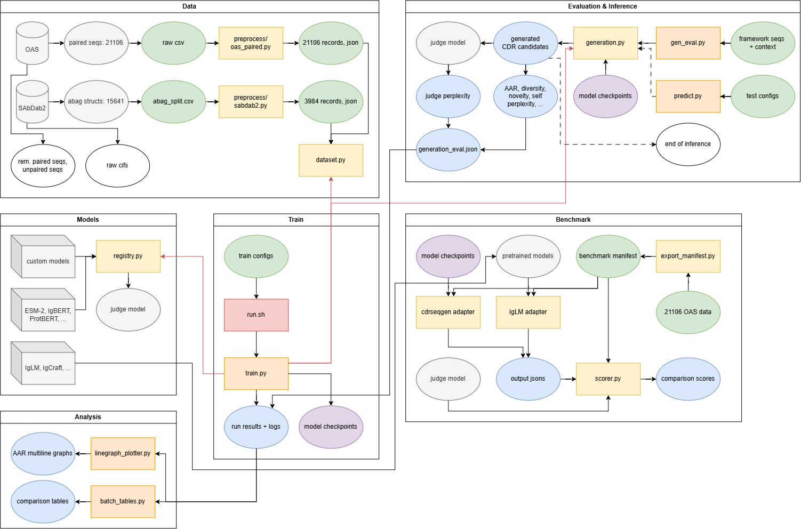

<!-- Note to AI: Edits allowed OUTSIDE of MANUAL PROTECTION ZONES and INSIDE of AI ACCESS ZONES -->
[← back to README](README.md)

*The operating manual: how to preprocess, train, visualize, sample, evaluate, and benchmark. Split
out of the README on 2026-08-31, where its 518 lines sat between the reader and the Findings. Kept
at the repository root so every relative path below — `scripts/`, `configs/`, `cdrseqgen/` — resolves
unchanged.*

**Results and their caveats live in the [README](README.md#-findings), not here.**

---
# 🚀 Workflow & Execution

## Architecture Overview



> The diagram is the 2026-08-14 snapshot. It predates the `cdrseqgen/methods/mlm/` consolidation and
> the `generate.py` / `evaluate.py` / `fit_mlm_length.py` renames; a refreshed diagram is pending.

## Step 1: Preprocessing Data
Convert datasets into a custom "Bio-Object" JSON format, extracting the regions and preserving `ANARCI` numbering.

**OAS**: currently only including 21106 paired sequences from 1287169_1_Paired_All.csv, pending future scale-ups
```bash
python -m cdrseqgen.data.preprocess.oas_paired \
    --input_file dataset/data/raw/1287169_1_Paired_All.csv \
    --output_file dataset/data/processed/processed_oas_data.json
```

For hyperparameter tuning, create a separate three-way file. Test clusters are allocated first using
the historical shuffle, so the established test membership is preserved; validation is then taken
from the former training partition:
```bash
python -m cdrseqgen.data.preprocess.oas_paired \
    --input_file dataset/data/raw/1287169_1_Paired_All.csv \
    --output_file dataset/data/processed/processed_oas_tuning.json \
    --split cluster --test_size 0.1 --validation_size 0.1 --seed 42
```

**SAbDab2**: currently including 3984 structures - paired with resolved antigen, remaining >10k structures without antigen pending future inclusion
```bash
python -m cdrseqgen.data.preprocess.sabdab2 \
    --input_file dataset/data/raw/sabdab2/splits_final/abag_split.csv \
    --output_file dataset/data/processed/processed_sabdab2_data.json
```

Processed records preserve provenance needed by external baselines and future multi-source datasets:
`species`, both original IDs in `chain_sequence_ids`, and a stable `source` block (OAS run or
SAbDab/PDB identifiers). OAS species is read from its raw metadata row; the current SAbDab2 source
has an empty species column, so those records deliberately store `"species": null` rather than
assuming human. Each preprocessing run also writes a hash-verified `*.metadata.json` sidecar with
source details, filters, numbering convention, and split parameters.

## Step 2: Training & Batch Experimentation
We use `.json` configuration files to manage hyperparameters cleanly. The trainer calculates **Sequence Recovery Rate** (Per-Residue Accuracy), logs to TensorBoard, and auto-generates metric graphs at the end of every run.

> **⚠️ Every config must declare `eval_split`.** The split named here drives early stopping,
> `load_best_model_at_end`, and every reported `eval_*` number, so leaving it implicit means
> selecting checkpoints on whichever partition happens to be non-train — which, on a two-way file,
> is the final test set. `get_datasets` now **refuses** to start when `eval_split` is unset and the
> dataset carries a `test` split. The 36 OAS configs declare
> `processed_oas_tuning.json` + `"eval_split": "validation"`; the 12 SAbDab2 configs declare
> `"eval_split": "test"` because that dataset ships no validation partition (an open problem, not
> an endorsement). Use `test` only after the settings are frozen.

**Run a Single Experiment:**
```bash
CUDA_VISIBLE_DEVICES=0 python train.py configs/h3_scratch.json
```

**Run an Automated Experiment Suite:** [`scripts/run.sh`](scripts/run.sh) takes a GPU id and one or more suite names, skips to the next config if one fails, and writes the round's tables and dashboards into the batch folder when it finishes (Step 3).
```bash
# One runner, suites chosen (and combined) by arg:  ./scripts/run.sh <gpu> [suite ...]
./scripts/run.sh 4                # default "all": OAS heavy + SAbDab2 antigen + OAS light (36)
./scripts/run.sh 4 oas            # OAS heavy matrix, scratch+ESM-2 (h1/h2/h3)          (12)
./scripts/run.sh 4 antigen        # SAbDab2 heavy antigen matrix (_ag / _ag_lconly)     (12)
./scripts/run.sh 4 lcdr           # OAS light matrix (l1/l2/l3, heavy-chain context)    (12)
./scripts/run.sh 4 oas lcdr       # combine suites — deduped, run in order              (24)

# Antibody/protein-BERT PLM backbones on OAS heavy (first run downloads a ~1.6GB model each)
./scripts/run.sh 4 igbert         # IgBert (antibody-specific)                           (6)
./scripts/run.sh 4 protbert       # ProtBert (general-protein baseline)                  (6)
./scripts/run.sh 4 plm            # both (igbert + protbert)                            (12)
```

**Every run lives at `results/runs/<batch>/<run>/` — always two levels under `runs/`.** A `run.sh` round shares one batch
folder; a standalone `train.py` gets a batch folder of its own, so `results/` never collects loose run
dirs. **`results/runs/latest`** is a symlink to the most recent *batch*, so `results/runs/latest/<config>/`
addresses any run in that round:

```text
results/runs/
├── 20260720_191138/                    ← one ./scripts/run.sh round
│   ├── h1_OAS_scratch/
│   ├── h3_OAS_LC_scratch/
│   ├── batch_tables.md                 ← the round's own report, written when it finishes
│   └── figures/                        ← batch_oas.png, batch_sd2.png
├── 20260720_193002/                    ← a single train.py run
│   └── h3_OAS_scratch/
├── 20260811_181946_sweep_h3/           ← validation-safe sweep; results/runs/latest unchanged
│   ├── h3_OAS_scratch_lr1e-4_wu0.0_wd0.0_s42/
│   ├── h3_OAS_scratch_lr1e-3_wu0.06_wd0.01_s43/
│   ├── runs.tsv  summary.tsv  grid.tsv ← the records you read
│   ├── figures/                        ← objective_comparison.png
│   └── logs/                           ← one stdout/stderr capture per trial
└── latest -> 20260720_193002/          ← newest batch; generate.py uses latest/<config>
```

Everything a round produces about *itself* sits at its own root: records as files, charts under
`figures/`, per-trial stdout under `logs/`. The logs are kept rather than dropped because a trial
that dies before logging attaches leaves no `train.log` — sometimes no run directory at all — so
that capture is the only evidence of the failure; they just no longer outnumber the records.

A named group is `<timestamp>_<name>` — the timestamp leads so directories sort chronologically
whether or not they carry a name (`20260730_160028_seedcheck`, `20260811_181946_sweep_h3`).

The run folder is named from the **resolved arguments**, not the config filename — `h3_scratch.json
--target_region l3` produces an `l3_OAS_HC_scratch` folder, so an override can't be misfiled. The
date/time lives on the batch folder and isn't repeated inside.

**Tag a run** with `CDRSEQGEN_RUN_SUFFIX` to distinguish runs that resolve to the same name:
```bash
CDRSEQGEN_RUN_SUFFIX=ablation_noLC python train.py configs/h3_scratch.json
#  -> results/<batch>/h3_OAS_scratch_ablation_noLC/
```
`sweep.sh` tags every trial with its LR, warm-up, weight decay, epochs and seed, so folders are
self-describing. It groups trials with `CDRSEQGEN_RESULTS_ROOT`, writes `runs.tsv`/`summary.tsv`, and
sets `CDRSEQGEN_SKIP_LATEST=1` so exploratory trials do not replace the main usable batch. If two runs
still collide, the second becomes `..._2` with a logged warning; a run never silently overwrites another.

A standalone `python train.py …` sets neither environment variable and retains the normal behavior.
Export `CDRSEQGEN_RESULTS_ROOT` yourself to group manual runs:
```bash
CDRSEQGEN_RESULTS_ROOT=results/runs/my_experiment python train.py configs/h3_scratch.json
```

**Override a config from the CLI:** trailing flags override the JSON (they do **not** replace it), so any
`TrainingArguments` field is tunable without writing a new config:
```bash
python train.py configs/h3_scratch.json --learning_rate 3e-4 --num_train_epochs 20 --warmup_ratio 0.06
```

The original `masking_policy: "full_span"` remains the default: every native CDR residue is replaced
by its own mask token. Opt into mixed-mask training when training a checkpoint for iterative
decoding:

```bash
python train.py configs/h3_scratch.json \
    --masking_policy mixed --mixed_full_span_probability 0.5
```

Mixed mode keeps the requested fraction of training examples fully masked. For every other example,
it reveals at least one native loop residue and masks at least one, with loss computed only over the
masked subset. Validation, post-training generation, and standalone evaluation always use a separate
`full_span` dataset view, so partially revealed native residues cannot leak into reported recovery.
Both settings are persisted in `run_config.json`.

**Choose a training loss:** ordinary token-averaged cross-entropy remains the default and therefore
reproduces old configs. The shared loss registry in
[`cdrseqgen/methods/mlm/losses.py`](cdrseqgen/methods/mlm/losses.py) is applied after model forward,
so scratch, ESM-2, IgBert, and ProtBert use the same implementation. The first alternative raises
the contribution of the hypervariable core relative to the easier loop anchors:

```bash
python train.py configs/h3_scratch.json \
    --loss_type weighted_cross_entropy \
    --core_loss_weight 2.0 --anchor_loss_weight 1.0 --anchor_trim 2
```

or, equivalently, from a config: [`configs/h3_scratch_weighted.json`](configs/h3_scratch_weighted.json)
is `h3_scratch.json` plus the three loss keys and nothing else, so the two differ only in objective.

The weighted objective is a weighted mean over supervised tokens, so only the core-to-anchor weight
ratio matters. `anchor_trim: 2` means the first and last two residues are anchors; loops of length
four or less contain no core and are treated entirely as anchors — on H3 that is 1 of 21,106 loops,
but on L2 it is 98.8% of them, so the weighted objective is an H3/H2/H1 tool and degenerates to plain
cross-entropy on the short light-chain loops. Setting `anchor_loss_weight 0` supervises the core only
(both weights zero is refused, as is a negative weight); a batch whose supervised tokens are all
anchors under that setting raises rather than emitting NaN. The same trim is passed to the
reported `core_accuracy`/`anchor_accuracy`, and original loop offsets keep the classification correct
under mixed masking. Loss settings and any `label_smoothing_factor` are persisted in
`run_config.json`.

**Tune on validation:** [`scripts/sweep.sh`](scripts/sweep.sh) runs a validation-only,
multi-seed screen. It takes a GPU id and a preset, the same way `run.sh` takes suite names:

| preset | grid | trials |
|---|---|---:|
| `h3` (default) | 4 LR × 2 warm-up × 2 weight decay × 2 seeds, fixed 30-epoch horizon | 32 |
| `pilot` | 3 LR × 2 epoch budgets — the 2026-07 "is the budget enough?" grid | 6 |
| `arch` | 3 widths × 2 depths, FFN tracking width | 6 |
| `loss` | 3 **distinct** objectives × 3 seeds, generative eval on, ranked by judge perplexity | 9 |
| `quick` | 2 trials at 2 epochs — checks the script runs, not for results |  2 |

The `loss` grid is `cross_entropy` plus four weighted settings (core/anchor `1.0/1.0`, `1.0/0.0`,
`3.0/1.0`, `3.0/0.0`) — but only **three** of those five are distinct objectives, so 24 nominal grid
points collapse to **9** trials.

> **Why five settings are three objectives.** `weighted_cross_entropy` is a weighted *mean* over
> supervised tokens, so the normaliser cancels any common factor and only the core-to-anchor
> **ratio** survives. Hence `weighted 1.0/1.0` is bit-identical to `cross_entropy` (verified to
> 1e-9) and `3.0/0.0` to `1.0/0.0`. The 08-25 screen ran all five before this was noticed, which is
> how Findings §13 ended up with the same loss occupying its top two ranks — a free measurement of
> run-to-run nondeterminism, and the reason §13 can say the objective differences are inside it.
> **Fixed 2026-08-31**: the grid materialiser canonicalises on the ratio and reports what it drops
> (`Grid: collapsed N trial(s)…`). To reproduce the determinism control deliberately, pass the two
> spellings explicitly rather than relying on the grid to duplicate them.

```bash
./scripts/sweep.sh 4                      # h3 preset
./scripts/sweep.sh 4 pilot
SEEDS="42 43 44" LRS="3e-4 1e-3" ./scripts/sweep.sh 4
SWEEP_DIR=results/runs/my_sweep ./scripts/sweep.sh 4   # resume into the same directory
./scripts/sweep.sh 4 loss
DRY_RUN=1 ./scripts/sweep.sh 4 loss       # print the grid, train nothing
```

Every dimension (`LRS`, `WARMUPS`, `WEIGHT_DECAYS`, `EPOCH_LIST`, `SEEDS`, `HIDDEN_SIZES`,
`NUM_LAYERS`, `MAX_EPOCHS`, `PATIENCE`, `LOSS_TYPES`, `CORE_WEIGHTS`, `ANCHOR_WEIGHTS`) is
env-overridable, so a preset only supplies defaults. Four knobs control what each trial is scored on:
`RANK_METRIC` (`core` | `whole` | `judge_ppl` | `diversity` | `gen_core`), `SELECT_METRIC`
(`core_accuracy` | `accuracy`), `GEN_EVAL` (`true`/`false`), and `GEN_EXAMPLES`/`GEN_SAMPLES`, which
shrink the generative eval — it runs once per trial, so the 150×20 default would dominate a 9-trial
sweep. The `loss` preset uses 100×10.

**`SELECT_METRIC` picks each trial's best checkpoint**, and it carries the same circularity as
ranking: `core_accuracy` is what a core-weighted objective optimises, so selecting on it advantages
those settings per-epoch even when the final ranking is judged independently. The `loss` preset
therefore defaults it to whole-span `accuracy`; every other preset keeps `core_accuracy`. Note
`eval_loss` is **not** an option — it is computed with each trial's own loss function, so its scale
differs between objectives and cannot be compared across them.

Rank by `judge_ppl` rather than `core` when comparing objectives: a loss that reweights core tokens
changes the very quantity `core` measures, so ranking on it partly rewards the objective for
optimising its own metric. The independent judge does not share that bias.

The script refuses a dataset without explicit `train`/`validation`/`test` labels, forces
`--eval_split validation`, ranks settings by mean best-epoch validation core recovery across seeds,
writes `runs.tsv`, `summary.tsv` and `objective_comparison.png`, never selects the test partition, skips already-completed grid
points on resume, and sets `CDRSEQGEN_SKIP_LATEST=1` so exploratory trials do not replace the main
usable batch. It also flags a winner whose margin falls below the ~0.006 seed-noise floor as a tie.

**On the `pilot` preset.** It sweeps `num_train_epochs`, which also reshapes the linear scheduler —
so a "20 epochs is better" result from it confounds budget with schedule. That is why `h3` fixes the
horizon and does not sweep the budget. `pilot` answers a different question (is the budget itself
enough?) and should not be used to select hyperparameters.

**Completed screen (2026-08-11).** All 32 trials completed on the three-way clustered OAS split
(16 settings × seeds 42/43). The leading region was shallow rather than decisive:

| LR | warm-up | weight decay | mean validation core recovery | seed SD | mean best epoch |
|---:|---:|---:|---:|---:|---:|
| **1e-3** | **0.06** | **0.01** | **0.32305** | 0.00138 | 16.5 |
| 3e-4 | 0.06 | 0.01 | 0.32269 | 0.00070 | 18.5 |
| 3e-4 | 0.00 | 0.00 | 0.32238 | 0.00032 | 13.5 |

The top-two gap is only 0.00036 and changes sign between the two seeds, so this screen identifies a
region, not a conclusive winner. Confirm the top two with additional shared seeds before freezing a
training config; evaluate the final choice only once on `test`. Full local records are in
`results/runs/20260811_181946_sweep_h3/{runs,summary}.tsv`.

## Step 3: Result Visualization & Comparison
All three recovery metrics are recorded **every epoch** (`compute_metrics` → `epoch_metrics.csv`:
`eval_accuracy`, `eval_core_accuracy`, `eval_anchor_accuracy`), and each run auto-generates four PNGs:

| file | shows |
|---|---|
| `eval_loss_curve.png` | loss |
| `eval_accuracy_curve.png` | whole-span recovery (anchor-inflated) |
| `eval_core_accuracy_curve.png` | **core** recovery — the one to report |
| `recovery_breakdown.png` | all three together — the anchor gap at a glance (H3: ~0.46 / ~0.32 / ~0.90) |

Use the **breakdown** chart to see the anchor gap, and the **individual** charts to read a trend: the
breakdown's y-axis spans ~0.3–0.9, which compresses within-line movement (ESM-2's core decay from
0.321 → 0.306 is legible on `eval_core_accuracy_curve.png`, barely visible on the breakdown).

### A finished round reports itself
What each run does for itself, a batch now does for the whole round — the report lands in the **batch
folder**, beside the runs it describes, so nothing has to be regenerated by hand to read a result.
Records sit at the batch root and charts under `figures/`, the same split `results/` uses one level up:

| written by | at the end of | into |
|---|---|---|
| `batch_tables.py` | `run.sh` | `<batch>/batch_tables.md` — every README comparison table |
| `batch_plots.py` | `run.sh` | `<batch>/figures/batch_<ds>.png` — one dashboard per dataset |
| `sweep_tables.py` | `sweep.sh` | `<sweep>/summary.tsv` — settings ranked across seeds |
| `sweep_plots.py` | `sweep.sh` | `<sweep>/figures/objective_comparison.png` — settings × seeds |

Both steps are guarded in the shell: a batch that already trained cannot be spoiled by a reporting
failure, and any of the four can be re-run against a finished directory at any time. That matters for
`sweep_tables` in particular — it used to be a heredoc at the end of `sweep.sh`, so an interrupted
sweep produced no summary at all, even though every finished trial was already on disk.

`results/figures/` stays for what does **not** belong to one batch: hand-picked charts for this
README, and ad-hoc comparisons spanning several batches (the two CLIs below still default there).

One function draws both comparison shapes, because every line is the same triple `(run_dir, column, label)`.
Each `--run` takes `LABEL FOLDER [METRIC]`; omit `METRIC` and it falls back to the global `--metric`
(default `eval_core_accuracy`):

```bash
# same metric across runs — metric named once
python -m cdrseqgen.visualization.linegraph_plotter \
  --metric eval_core_accuracy \
  --run "H3 Scratch" "results/20260729_202635/h3_OAS_scratch" \
  --run "H3 ESM-2"   "results/20260729_202635/h3_OAS_esm2_t12_35M_UR50D" \
  --title "H3 Core Recovery: Scratch vs ESM-2"

# breakdown of ONE run — per-run metric, several columns on one chart
python -m cdrseqgen.visualization.linegraph_plotter \
  --run whole  "results/runs/latest/h3_OAS_scratch" eval_accuracy \
  --run core   "results/runs/latest/h3_OAS_scratch" eval_core_accuracy \
  --run anchor "results/runs/latest/h3_OAS_scratch" eval_anchor_accuracy \
  --ylabel Recovery --title "H3 whole vs core vs anchor"
```

A missing CSV or column is reported and skipped rather than aborting the chart, so one bad path in a
multi-run comparison doesn't lose the other lines. Charts default to `results/figures/training/`.

<!-- > **⚠️ Never mix datasets on one chart.** OAS (`_OAS`) and SAbDab2 (`_SD2`) runs are evaluated on *different test sets*, so their accuracies are not comparable on shared axes — plot one graph per dataset (e.g. `cdr3_oas` with the 4 OAS runs, `cdr3_sd2` with the 4 SAbDab2 runs). The `results/comparisons/*_oas_*.png` / `*_sd2_*.png` pairs follow this convention. -->

## Step 4: Qualitative Sampling on Curated Frameworks (`generate.py`)
Give it a framework with its CDR loop cut out (`pt1` / gap / `pt2`) and it fills the gap: samples a
library of candidate loops (default **iterative**) and prints them, each with recovery-vs-native (when
you provide the native) and pseudo-perplexity, plus per-framework diversity/novelty. It also reports
which CDR the checkpoint was trained for (read from `run_config.json`). Samples + metrics are written to
`<model_path>/generation_results.json`.

> **This is a showcase, not an evaluation.** `showcase/*.json` holds only a handful of curated
> frameworks (mostly without natives). For numbers you can report, use **Step 5**, which draws real
> held-out frameworks straight from the eval split.

> **⚠️ Match the checkpoint's context, or the model silently underperforms.** A checkpoint trained with
> partner-chain or antigen context does not *fail* on a bare framework — the input is merely
> out-of-distribution, so it quietly produces bad loops. Measured on `h1_OAS_LC_scratch`, 60 held-out
> frameworks, greedy: **0.9858** recovery with the light chain supplied as trained, **0.2599** without.
> In the latest batch **24 of 36 checkpoints** need context.
>
> Pass it with `--partner_chain` / `--antigen` (or per-case `partner_chain` / `antigen` keys in a
> `--test_file`), and set `--max_len` to the training config's value (512 for the SAbDab2 antigen runs).
> `generate.py` reads `run_config.json`, prints what the checkpoint expects, and **refuses** a context
> mismatch in either direction unless `--force` — supplying context a model never saw is as damaging
> as withholding context it needs (0.308 → **0.000** on `h3_OAS_scratch` with a partner chain
> prepended), because for an absolute-position backbone it shifts every learned position. Injection
> goes through the same `inject_context` / `assemble_masked_input` that build the training examples,
> so which side the antigen lands on — and which side gets truncated — follows the backbone's
> `position_type` automatically instead of being hand-encoded in the test file.
>
> The **loop** is a weaker signal and is treated accordingly. Nothing in the tensor names a loop or a
> chain, so which CDR you are designing is fixed by which checkpoint you load; `--target_loop` only
> *declares* your intent and cannot change the computation, so a mismatch **warns** rather than
> refuses — the input is still well-formed, just answered by weights fitted for another loop, which
> is a legitimate thing to probe. Because that check is opt-in, one more runs unconditionally: the
> length of `pt1` says where along the chain the gap sits, and across all 50,180 frameworks in both
> processed datasets the three CDR numbers separate cleanly (CDR1 8–26, CDR2 33–57, CDR3 78–106).
> That catches an h3 checkpoint fed an H1 framework with nothing declared, which was previously
> silent. Only the **number** is inferable — H1 (23–25) and L1 (24–26) overlap outright — so a
> heavy/light mix-up still cannot be detected this way.

```bash
# design coherent loops for a batch of curated frameworks (default: iterative sampling)
# results/runs/latest is the newest batch — name the config under it (here: h3_OAS_scratch)
python generate.py --model_path ./results/runs/latest/h3_OAS_scratch --test_file showcase/h3.json --use_native_length

# more candidates + nucleus sampling
python generate.py --model_path ./results/runs/latest/h3_OAS_scratch --test_file showcase/h3.json \
    --use_native_length --decoding iterative --num_samples 50 --top_p 0.9

# a single framework straight from the CLI (equal bounds mean an exact length)
python generate.py --model_path ./results/runs/latest/h3_OAS_scratch --pt1 EVQL...YYCAR --pt2 WGQGT... \
    --min_length 17 --max_length 17

# constrain each sampled length to an inclusive range (one-sided bounds also work)
python generate.py --model_path ./results/runs/latest/h3_OAS_scratch --pt1 EVQL...YYCAR --pt2 WGQGT... \
    --min_length 11 --max_length 15 --num_samples 50

# infer length from the framework: omit target_length/min_length/max_length
python generate.py --model_path ./results/runs/latest/h3_OAS_scratch --pt1 EVQL...YYCAR --pt2 WGQGT... \
    --num_samples 50
```

Length selection passes through one explicit policy layer. Equal bounds request an exact fixed
length; unequal or one-sided bounds truncate and renormalize the checkpoint's learned length
distribution; omitted bounds sample that distribution without consulting the native target. A
`target_truth` is scoring-only unless `--use_native_length` is passed explicitly, preventing silent
length leakage. `--target_length` remains as a deprecated fixed-length alias. Every result stores the
policy, bounds, constrained probabilities, selected lengths, and prompt truncation under
`length_policy`.

The sequence backbone is still an encoder-only MLM: one **gap sentinel** is classified into a length,
then expanded into that many residue masks before the existing decoder runs. New training runs fit
and save `length_config.json` plus `length_head.safetensors` beside the best sequence checkpoint by
default; the sequence weights remain frozen during this fit. For a checkpoint trained before these
artifacts existed, run:

```bash
python fit_mlm_length.py --model_dir results/path/to/old_run
```

This discovers the run's saved `run_config.json`, keeping the original processed dataset and split.
Use `--config path/to/config.json` only when the checkpoint has no saved run configuration.
Inspect the resulting `length_config.json` before generation: its held-out `eval_accuracy` and
`eval_length_mae` should improve on `eval_mode_baseline_accuracy` and
`eval_mode_baseline_length_mae`; otherwise the head is mostly reproducing the training-set mode.

> **First result (2026-08-17): the mechanism works, but this length head does not yet beat the naive
> baseline.** On the full 2,111-framework validation split, the tuned scratch checkpoint's head
> reached 9.24% exact-length accuracy and 3.64 MAE, versus 10.52% and 3.28 for always predicting the
> training mode (length 15). See Finding §10; this is an open modeling result, not a software failure.

`--decoding`: `independent` (per-position sampling, 1 forward pass) · `iterative` (confidence-ordered
Mask-Predict — conditions each residue on those already committed). **`--temperature 0` makes either
deterministic (greedy)** and returns a single loop. Warp with `--temperature` / `--top_k` / `--top_p`;
`--skip_perplexity` drops the compute-heavy scoring.

> **⚠️ The two decoders are currently equivalent — use `independent` for sweeps.** Measured 2026-07-28
> on `h3_OAS_esm2`, 150 stratified frameworks, 20 samples, `top_p 0.9`, seed 42, IgBert judge:
>
> | metric | iterative | independent | Δ |
> |---|---|---|---|
> | recovery | 0.4057 | 0.4072 | +0.0015 |
> | diversity | 0.5731 | 0.5703 | −0.0028 |
> | entropy (bits) | 1.8414 | 1.8242 | −0.0171 |
> | judge-ppl | 7.1434 | 7.2259 | +0.0825 |
>
> Every difference is within noise, while iterative costs **~15×** the forward passes (one per masked
> position; mean H3 length 15.1). Mask-Predict only helps when the loop joint differs from the product
> of per-position marginals — getting identical numbers says this masked-LM has learned near-independent
> marginals for H3. That is a limit of the **training objective**, not of the sampler, and it is direct
> evidence for the "marginal-based, not learned-joint" open problem below.

## Step 5: Generative Evaluation on the Held-Out Split (`evaluate.py`)
The reportable version of Step 4. Reconstructs the **exact training-time eval split** from the config
(same clustered leakage-safe holdout, same partner/antigen injection, a real native on *every*
framework — 2,111 held-out antibodies for OAS), samples `--num_samples` candidates each, and aggregates
the generative metrics — overall **and bucketed by H3 length**, since difficulty scales with it.

```bash
python evaluate.py \
    --config configs/h3_esm2.json \
    --model_dir results/20260710/20260710_184547_h3_OAS_esm2_t12_35M_UR50D \
    --num_examples 150 --stratify --num_samples 20 \
    --top_p 0.9 \
    --judge Exscientia/IgBert
```

`evaluate.py` checks the supplied config against the checkpoint's `run_config.json` before loading
weights. A target-loop, backbone/tokenizer, context, dataset, maximum-length, or masking-policy
mismatch stops the run because it would change the model's inputs or invalidate the interpretation.
`--force` is reserved for deliberate off-contract experiments and records every mismatch in the
output. Decoder selection is also policy-aware: `full_span` checkpoints use `independent`;
`mixed` checkpoints use their recorded decoder (or `iterative` when none was recorded). Passing
`--decoding iterative` explicitly remains possible, with an off-distribution warning on a
`full_span` checkpoint.

The command above is the original `fixed_native` track. Use the checkpoint length head for a bounded
or fully inferred sweep:

```bash
# inclusive range; either min or max may be omitted
python evaluate.py --config configs/h3_esm2.json --model_dir results/path/to/run \
    --length_mode bounded --min_length 11 --max_length 15 --num_samples 20

# no native mask count is supplied to generation
python evaluate.py --config configs/h3_esm2.json --model_dir results/path/to/run \
    --length_mode inferred --num_samples 20
```

Positional AAR/core/anchor recovery is calculated only for candidates whose generated length matches
the native loop. All valid candidates still contribute to length-match rate, length MAE,
alignment-aware edit similarity, diversity, validity, runtime, and judge perplexity.

> **⚠️ Self-perplexity is NOT comparable across models.** Pseudo-perplexity is scored under each model's
> *own* distribution, so it measures self-consistency — a model confident in its own outputs looks good
> regardless of quality. To compare models, pass `--judge <model_type>`: every candidate is then also
> scored by one **independent** reference LM (IgBert is a good pick — antibody-specific, and independent
> of both scratch and ESM-2). Diversity/entropy carry no such caveat; they're purely sequence-based.

`--num_examples K` subsamples the split (`-1` = all; default 200); `--stratify` balances the draw across
short/medium/long H3 buckets so rare long loops aren't washed out. Manual results land in a
parameter-addressed file under `<model_dir>/evaluations/`, so a temperature or seed sweep cannot
silently replace the training-time result. Repeating the exact same output path is refused unless
`--overwrite` is explicit. The JSON records checkpoint/config/data hashes, repository state,
compatibility checks, decoder settings, and the anchor definition.

### Generative evaluation runs automatically after every training run
Once all epochs finish, `train.py` fits the frozen-backbone length head, samples designs from the
finished best model, and writes `generation_eval.json` beside `epoch_metrics.csv`. Both the length
fit and fixed-native generative evaluation are **on by default** — no config change is needed.

It samples from **`trainer.model`** (with `load_best_model_at_end` that's the peak checkpoint, already
on the GPU, so nothing is reloaded from disk), runs last, and is exception-guarded: a generation
failure logs a warning and **cannot** damage a training run that already finished and saved.

Every candidate is also scored by an **independent judge** (`gen_judge`, default
`Exscientia/IgBert`), which is what makes perplexity comparable *across* runs — self-perplexity is
not. Comparability requires the same judge in every run, **not** the same process, so per-run
judging is valid. Tune or disable via config:

```json
"run_generative_eval": true,
"gen_num_examples": 150,
"gen_num_samples": 20,
"gen_decoding": "independent",
"gen_top_p": 0.9,
"gen_length_mode": "fixed_native",
"gen_min_length": null,
"gen_max_length": null,
"gen_length_temperature": 1.0
```

Set `run_generative_eval: false` (or `gen_judge: ""` to keep the metrics but skip the judge) to opt out;
trim `gen_num_examples` for cheap runs. Cost is ~80s of sampling + ~15s to load the judge per run.

Both evaluation paths share the MLM evaluation implementation
([`cdrseqgen/methods/mlm/evaluation.py`](cdrseqgen/methods/mlm/evaluation.py)); they differ only in
where the model comes from. **Both length tracks also share one loop**: `run_eval_loop` owns example
selection, scoring, judging, reporting, and writing, while a *strategy* owns the one thing that must
not be shared — turning an eval index into candidates. `FixedNativeStrategy` reads the dataset's own
masked view (so the mask count is the native one and the context is exactly what training used);
`VariableLengthStrategy` ([`variable_length_evaluation.py`](cdrseqgen/methods/mlm/variable_length_evaluation.py))
rebuilds the framework and lets the checkpoint's length head decide. Before this, the two tracks were
separate 130-line functions that had already drifted apart in four ways (progress bar, write guard,
summary statistic, empty-mask guard) — differences that make two tracks quietly incomparable.

Length policy, checkpoint-specific classification, mask expansion, and independent-versus-iterative
decoder dispatch live in [`cdrseqgen/methods/mlm/`](cdrseqgen/methods/mlm/). Future autoregressive
and encoder-decoder methods can be added beside `mlm/` without inheriting its mask-token,
pseudo-perplexity, or length-expansion assumptions. The MLM primitives are shared by `generate.py`,
both held-out evaluation paths, and the CDRSeqGen benchmark adapter — all of which now reach the
decoder through the single `sample_length_conditioned_spans` entry point, so a fixed length is
simply the case where the length is known before the prompt is built rather than predicted from it.
`evaluate.py` stays the tool of choice for
scoring checkpoints you already trained, or re-sweeping temperature / top-p / judge without
retraining.

## Matched External Benchmark

The frozen-manifest CDRSeqGen–IgLM validation and final-test workflow is documented in
[`benchmark/README.md`](benchmark/README.md). Generation remains model-specific in the two adapters;
[`benchmark/scorer.py`](benchmark/scorer.py) validates the matched contract and applies one shared
metric implementation. Validation-smoke results are development checks, not final benchmark claims.

Current length-free status (2026-08-17): the tuned scratch adapter completed all 25 validation
frameworks × 20 candidates with zero failures and a 6.0% sampled native-length match rate. IgLM's
matched natural-EOS output, shared scoring, and the comparison plot are still pending; therefore no
length-free CDRSeqGen-versus-IgLM claim exists yet.

---
