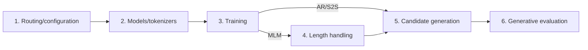
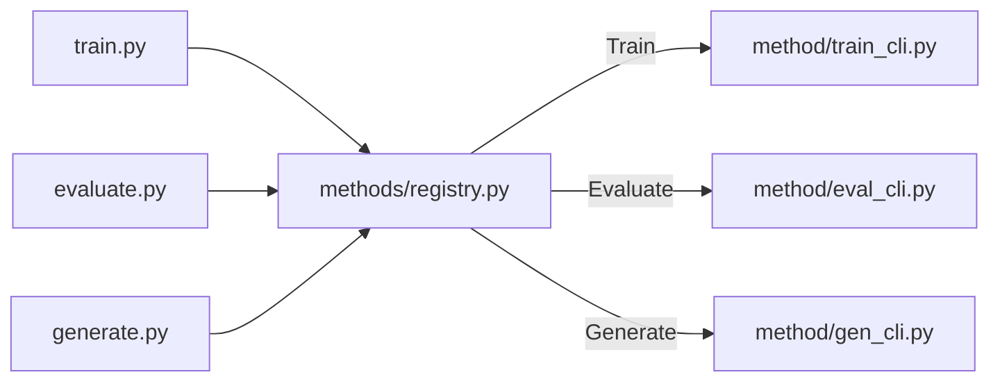
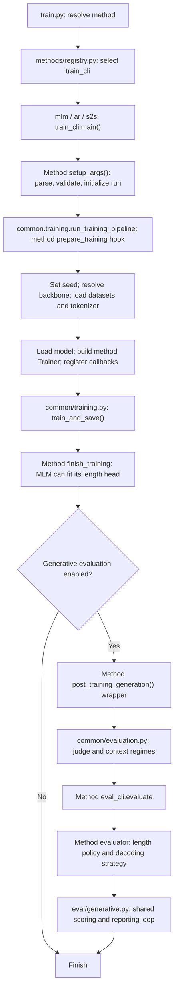

# Shared method workflow

Use this map when reviewing `methods/`: follow one stage through MLM, AR and
S2S, then review the shared behaviour and its placement in `common/`.

Each method's three CLI modules configure logging and connect method functions to
shared workflows. Training also parses arguments; root evaluation/generation commands
already supply parsed inputs. `common.training.run_training_pipeline()` orders each
method's preparation, shared training/saving and method extensions. `common/`
implements shared stages and utilities; it does not have an executable `main()` that
the methods inherit or override. Argument classes inherit shared base classes;
backbone descriptors and ordered registry mechanics also live in common.
AR and S2S also share `common/eos_decoding.py`: their recovery arithmetic, dataset
split, evaluation strategy and generation record, which differ only in the
conditioning input, the sampler and how predictions line up with labels.
The reference skeleton below describes the common sequence and its extension
points using the existing callers.

## Review chunks

Use six conceptual chunks. For each chunk, review **MLM -> AR -> S2S -> common**:
trace MLM as the original implementation, compare what changes in AR and S2S,
then review the shared contract and whether its placement in `common/` is clear.
Follow existing common helpers when a method calls them; revisit their ownership
after comparing the methods. A chunk can take several reading sessions. Entry
functions can be read first for orientation and revisited when their callees
have been reviewed.

| Chunk | Files to review | Question to settle |
|---|---|---|
| **1. Routing and configuration** | `methods/registry.py`; common and method `arguments.py`; method `train_cli.py`, `eval_cli.py` and `gen_cli.py`; root `train.py`, `generate.py`, `evaluate.py` as callers | Which command selects the method, how are settings resolved, and which stages does it invoke? |
| **2. Models and tokenizers** | Common and method `backbones.py`; method `models/` | How are models and tokenizers built, saved and reloaded, and what input/output contract do they expose? |
| **3. Training and checkpoint selection** | Common and method `training.py`; common `callbacks.py` and `losses.py`; MLM `losses.py` and `recovery.py`; AR/S2S metrics and dataset split in common `eos_decoding.py`; S2S `diagnostics.py` | What is supervised, how is loss computed, and how do validation, callbacks and checkpoint selection control the run? |
| **4. MLM length handling** | MLM `length.py`: policies, prompts, fitted head, span sampling and evaluation adapters; length-related call sites in arguments, command modules and generation | What length information is allowed, how is the head fitted/loaded, and how does a policy produce a chosen length? |
| **5. Candidate generation** | Common `generation.py` and common/method `sampling.py`; MLM and AR/S2S `generation.py` (AR/S2S records come from common `eos_decoding.py`) | How do context and decoding settings become candidate loops, and when is a draw considered complete? |
| **6. Generative evaluation** | Common and method `evaluation.py`; MLM strategies in `length.py`; AR/S2S strategy in common `eos_decoding.py`; the already-reviewed `eval/generative.py` and `eval/metrics.py` as shared dependencies | How are candidates and native references passed separately into generation/scoring, how is judge context built, and which populations contribute to reported metrics? |

The conceptual training path is:



For generation/evaluation of an existing checkpoint, chunk 2 loads the saved
model, chunk 4 loads the MLM length artifacts when required, and training is
skipped. AR/S2S choose length through EOS in chunk 5.

`train_cli.py` starts training runs; each method passes `training.prepare_training()` and
`training.finish_training()` into `common.training.run_training_pipeline()`.
`gen_cli.py` and `eval_cli.py` supply
method-specific functions to the standalone `generate.py` and `evaluate.py`
commands respectively. Callbacks are wired where the Trainer is constructed
and act during training. MLM's fixed-native and variable-length strategies live
beside their prompt and length APIs in `length.py`. S2S diagnostics
are an optional training extension.

For each chunk, record its callers, inputs, outputs and method-specific
extensions. Shared run setup, logging and exports now live here in `run_setup.py`,
`logging.py`, `callbacks.py` and `record_results.py`. Review their implementations
as a separate chunk; moving them does not mark them manually reviewed.

## Root command interfaces

Each root command selects a method through `methods/registry.py` and calls the
matching module in that method's package. The same names are used for MLM, AR
and S2S:

| Root command | Method module | Calls | Shared flow |
|---|---|---|---|
| `train.py` | `train_cli.py` | `main()` | Connect method preparation/finish hooks to `common.training.run_training_pipeline()` |
| `evaluate.py` | `eval_cli.py` | `main(args, config, run_config)` | Connect method setup and scoring to `common.evaluation.run_evaluation_pipeline()` |
| `generate.py` | `gen_cli.py` | `main(args, config)` | Connect method setup, state and case production to `common.generation.run_generation_pipeline()` |



All three methods expose the same entry-function pattern:

```text
train_cli.main() -> common.training.run_training_pipeline()
                -> training.prepare_training() / finish_training()
eval_cli.main()  -> common.evaluation.run_evaluation_pipeline()
                -> evaluation.run_generative_eval()
gen_cli.main()   -> common.generation.run_generation_pipeline()
                -> generation.generate_case()
```

The root evaluation/generation commands parse arguments, read routing metadata
and call one method `main()`; their decoder, sampling and length flags are one
shared definition (`arguments.add_sampling_arguments()`), and all three commands
expose `main()` as the entry point. Root training selects a method and leaves
parsing to its command module. The evaluation/generation commands supply their setup and execution functions
to `common/evaluation.run_evaluation_pipeline()` or
`common/generation.run_generation_pipeline()`. Those lifecycles handle shared
compatibility checks, model/data loading and output setup. Generation preserves
case order and delegates each scored record to the method's case producer.
All three methods' evaluation and generation CLI modules supply their functions
directly from `main()`.

All three training commands use the same shared workflow: `prepare_training()`
returns a Trainer/tokenizer, `train_and_save()` trains/evaluates/saves, and
`finish_training()` runs method extensions and optional generated-loop evaluation.
MLM can fit its length head in the finish hook; AR/S2S generate to EOS.

`eval_cli.evaluate` remains the lower-level evaluator for already loaded resources.
Post-training evaluation uses it through `Method.evaluate()` and does not repeat
the standalone model/data loading lifecycle.

All three methods validate decoder/length options for their two saved-checkpoint
commands through `arguments.validate_inference_args()` (AR/S2S also set
`args.decoding`; MLM leaves that to `evaluation.resolve_decoding()`, which also
serves `generation.prepare_generation()`). MLM's per-case length helper belongs to
`length.py`. The CLI modules import only what `main()` wires up.

## Relationship graph



Inside `train_and_save()`:

```text
do_train?
  yes -> attach tokenizer-save callback, when supported
      -> trainer.train()
      -> save model, train metrics and tokenizer
do_eval?
  yes -> trainer.evaluate()
      -> save evaluation metrics
export epoch CSV and training curves
```

The Trainer invokes registered callbacks during this lifecycle. For example,
`LogMetricsCallback.on_log()` records metrics, and the optional early-stopping
callback reacts to evaluation. The method's sampling and loss implementations
have separate roles: the model, Trainer, collator and metric functions supply
training behaviour; later, the method's evaluator and sampler supply generation.

### Loss calculation and Trainer integration

MLM keeps its existing imports from `methods/mlm/losses.py`. Each objective has
one calculation block followed by `register_loss(...)`, which declares its name,
aliases and whether target offsets/lengths are required. `LossConfig` validates
the settings; `calculate_mlm_loss()` checks the batch and selects the calculation.

```text
common/training.ExternalLossTrainer.compute_loss()
  -> separate labels/loss metadata from model inputs
  -> model(**model_inputs)
  -> mlm/losses.MLMLossTrainer.loss_from_outputs()
       -> calculate_mlm_loss() -> registered objective
            -> common/losses.token_cross_entropy()
  -> return scalar loss, optionally with the original model outputs
```

The common Trainer owns the handoff; the MLM subclass supplies its metadata
keys and objective. Common token CE assumes logits and labels are already
aligned. MLM's original-loop core/anchor weights stay in its loss module.
AR/S2S continue using their models' own losses through the ordinary Trainer.
Both MLM objectives retain their microbatch mean reduction; gradient accumulation
does not change them into a single token-weighted mean over all microbatches.

To add an MLM objective, implement the five-argument calculation next to a new
registration. The registry supplies aliases, accepted names and metadata needs,
so argument parsing and the Trainer do not need a new loss-specific branch.

## Reference training workflow

This is a reading skeleton, not a runnable command. It combines command setup
and method execution to show their stage order. MLM keeps parsing and hook wiring
in [train_cli.py](../mlm/train_cli.py). The common workflow calls
[training.prepare_training() / finish_training()](../mlm/training.py) around the
shared Trainer lifecycle; [AR](../ar/training.py) and [S2S](../s2s/training.py)
supply the same two hooks, wired in their `train_cli.py`. Ellipses represent each
method's construction code.

```python
def reference_workflow():
    # Method arguments extend the shared bases and validation.
    model_args, data_args, gen_args, training_args = setup_args()
    set_seed(training_args.seed)

    backbone = resolve(model_args.model_type)
    train_ds, eval_ds, tokenizer = get_datasets(
        model_args, data_args, training_args, backbone
    )
    update_latest_link(training_args.output_dir)
    model = backbone.load_training_model(model_args.model_type, ...)

    # MLM prepares its loss configuration before constructing its Trainer.
    # AR records its training layout before constructing the Trainer.
    callbacks = build_callbacks(model_args, training_args, logger)
    trainer = ...  # MLM: MLMLossTrainer; AR/S2S: their Trainer builders.
                   # Supply the model, datasets, collator, metrics and callbacks.
    # S2S attaches optional conditioning/stop callbacks here.

    train_and_save(trainer, training_args, tokenizer=tokenizer)

    # MLM optionally fits the length head on the resulting sequence model.
    if gen_args.run_generative_eval:
        post_training_generation(...)  # Method options enter the shared setup.
```

## Stage ownership

Paths in this table are relative to `cdrseqgen/`.

| Stage | Shared implementation | Method implementation or extension |
|---|---|---|
| Route a training request | `methods/registry.py`, root `train.py` | `<method>/train_cli.main()` |
| Orchestrate the configured run | `common.training.run_training_pipeline()`: prepare → train/evaluate/save → finish | `train_cli.main()` supplies the method's `prepare_training` and `finish_training` |
| Prepare standalone evaluation | `common/evaluation.run_evaluation_pipeline()`: checks, data/model/judge loading and output setup | `eval_cli.main()` supplies method-specific setup and evaluator functions |
| Generate supplied frameworks | `common/generation.run_generation_pipeline()`: checks, loading, case coordination and output writing | `gen_cli.main()` supplies setup, state and case functions; each method builds and scores records in `generation.generate_case()`; AR/S2S delegate to `common/eos_decoding.eos_case_record()` |
| Parse and validate settings | `methods/common/arguments.py`: base classes, parsing, validation, run initialization, and the flags `evaluate.py`/`generate.py` share (`add_sampling_arguments()`) | `<method>/arguments.py`: additional fields, validation and `setup_args()` |
| Load input views and splits | `datasets/dataset_common.py`: context and split helpers | `<method>/training.get_datasets()` (AR/S2S through `common/eos_decoding.get_infilling_datasets()`) and `datasets/dataset_<method>.py` |
| Load backbone and tokenizer | `methods/common/backbones.py`: shared descriptor, ordered registry and checkpoint/tokenizer helpers | `<method>/backbones.py`: its own registry instance, registrations and loaders; AR extends tokenizer construction with span-layout checks; S2S assembles its encoder/decoder; concrete models stay in `<method>/models/` |
| Build a custom Transformer | `methods/common/transformer.py`: dimension validation, rotary self-attention, FFNs and weight initialization | `<method>/models/`: configuration, model layout, forward contract and label/loss alignment |
| Build Trainer | `methods/common/callbacks.build_callbacks()`; `methods/common/training.ExternalLossTrainer` supplies the external-loss handoff | MLM loss Trainer and recovery metrics; AR/S2S Trainer builders, collators and metrics |
| Calculate token loss | `methods/common/losses.token_cross_entropy()`: aligned token CE | MLM loss registry and core/anchor weighting; AR/S2S models calculate their own losses. The open end for a selectable AR/S2S loss is `build_trainer(compute_loss_func=...)`: Hugging Face's `f(outputs, labels, num_items_in_batch=None)`, which must align the labels itself (AR shifts, S2S does not) and divide by the count when given (`test_loss_normalization` shows a function that does reproduces the model's loss) |
| Run training and teacher-forced evaluation | `methods/common/training.train_and_save()` | The supplied model and Trainer determine loss, inputs and metrics |
| Run post-training generative evaluation | `methods/common/evaluation.post_training_generation()`: judge, context regimes and artifact setup | Method wrapper supplies decoding/length options; method evaluator supplies the strategy |
| Draw, score and report candidates | `eval/generative.py`, `eval/metrics.py`, `methods/common/sampling.py` | Method sampling, length selection, self-scoring and judge input construction; AR/S2S share the strategy bookkeeping in `common/eos_decoding.py` |

`<method>/` in the last column means `methods/mlm/`, `methods/ar/` or
`methods/s2s/`. Run logging and metric exports live in `methods/common/`,
as described below.

## Custom model extension points

See the [model specifications](../../../docs/MODELS.md) for the architecture comparison,
builder defaults and saved main-benchmark settings to use when writing the paper.

Each current custom model follows `Config → Model → build_model()`. MLM keeps
learned absolute positions and bidirectional attention; AR/S2S reuse
`common.transformer.RotarySelfAttention`, while their stack layout and label
alignment stay method-owned. S2S cross-attention has no rotary positions.
Checkpoint config identifiers and parameter paths remain stable.

A new architecture can live in another file under its method's `models/` directory
and supply a backbone registration with its tokenizer, builder and checkpoint loader.
The optional `validate_model_args(model_args, data_args)` callback declares that
family's architecture checks. Method argument setup calls
`backbone.validate_training_args()` before creating the run directory, so a custom
model name does not have to equal `scratch`. Current Transformer registrations use
`common.transformer.validate_transformer_args()`; another architecture can provide
its own validator. The existing baseline remains selected by `scratch`.

## Run setup, logging and recording

| Module | Responsibility | Main callers |
|---|---|---|
| `logging.py` | Configure stdout, attach `train.log`, log uncaught exceptions | All method CLI entrypoints; shared argument setup attaches the training file handler |
| `run_setup.py` | Select/name output directories, update latest, save resolved configuration/provenance, supply dataset tags | Shared argument setup, method training workflows, visualization tables |
| `callbacks.py` | `LogMetricsCallback` records Trainer log events; `build_callbacks()` adds requested early stopping | Method Trainer construction |
| `record_results.py` | Export the epoch trajectory CSV and training-curve PNGs | `training.train_and_save()` |
| `eos_decoding.py` | AR/S2S only: pooled recovery metrics, infilling dataset split, evaluation strategy and payload, generation record | AR and S2S `training.py`, `evaluation.py`, `generation.py` |

Run configuration remains flat, with the same artifact names and dataset tags.
The provenance checkout is located from the `cdrseqgen` package, independently
of these modules' directory depth. The former `cdrseqgen/train/` package has
been removed; active code imports these shared modules directly.

## Method extension points

| Location in the sequence | MLM | AR | S2S |
|---|---|---|---|
| Before Trainer construction | Prepare loss configuration; construct `MLMLossTrainer` with recovery metrics | Record training layout; construct causal Trainer | Construct encoder-decoder Trainer with already-offset decoder labels |
| Before the shared training lifecycle | Callbacks returned by `build_callbacks()` | Same shared callbacks | Shared callbacks plus optional `ConditioningProbe` callback |
| After the shared training lifecycle | When training and length-head fitting are enabled, fit the frozen-backbone length classifier | Continue to optional generation | Continue to optional generation |
| During generation | Independent/iterative residue decoding with fixed, bounded or inferred length | Causal decoding until EOS | Encoder-decoder decoding until EOS |

These are the composition points of the method training workflows: `run_training_pipeline()`
accepts each method's preparation and finishing hooks. Review the ordering and data passed
through each stage, including the conditions under which optional steps run. The graph is also
a checklist for finding duplicated behaviour or steps whose ownership is unclear.
