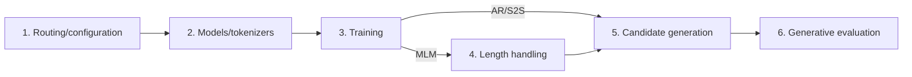
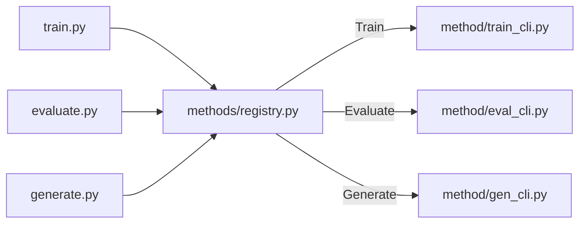
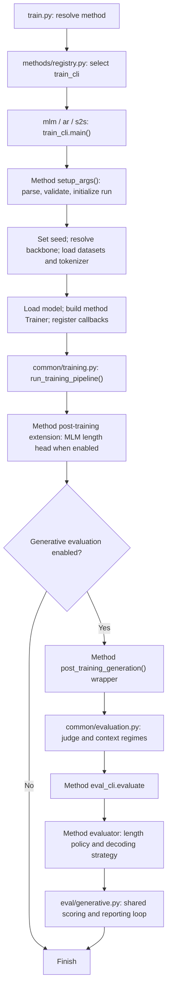

# Shared method workflow

Use this map when reviewing `methods/`: follow one stage through MLM, AR and
S2S, then review the shared behaviour and its placement in `common/`.

Currently, each method's `train_cli.main()` orders the training run. `common/` implements
shared stages and utilities; it does not have an executable `main()` that the
methods inherit or override. Argument classes do inherit shared base classes.
The reference skeleton below describes the common sequence and its extension
points using the existing callers.

## Review chunks

Use six conceptual chunks. For each chunk, review **MLM -> AR -> S2S -> common**:
trace MLM as the original implementation, compare what changes in AR and S2S,
then review the shared contract and whether its placement in `common/` is clear.
Follow existing common helpers when a method calls them; revisit their ownership
after comparing the methods. A chunk can take several reading sessions. Entry
functions can be read first for orientation and revisited when their callees
have been reviewed.

| Chunk | Files to review | Question to settle |
|---|---|---|
| **1. Routing and configuration** | `methods/registry.py`; common and method `arguments.py`; method `train_cli.py`, `eval_cli.py` and `gen_cli.py`; root `train.py`, `generate.py`, `evaluate.py` as callers | Which command selects the method, how are settings resolved, and which stages does it invoke? |
| **2. Models and tokenizers** | Common and method `backbones.py`; method `models/` | How are models and tokenizers built, saved and reloaded, and what input/output contract do they expose? |
| **3. Training and checkpoint selection** | Common and method `training.py`; common `callbacks.py`; MLM `losses.py` and `recovery.py`; S2S `diagnostics.py` | What is supervised, how is loss computed, and how do validation, callbacks and checkpoint selection control the run? |
| **4. MLM length handling** | MLM `length.py` and `length_predictor.py`; length-related call sites in arguments, command modules and generation | What length information is allowed, how is the head fitted/loaded, and how does a policy produce a chosen length? |
| **5. Candidate generation** | Common and method `sampling.py`; MLM `generation.py`; method `case_generation.py` | How do context and decoding settings become candidate loops, and when is a draw considered complete? |
| **6. Generative evaluation** | Common and method `evaluation.py`; MLM `variable_length_evaluation.py`; the already-reviewed `eval/generative.py` and `eval/metrics.py` as shared dependencies | How are candidates and native references passed separately into generation/scoring, how is judge context built, and which populations contribute to reported metrics? |

The conceptual training path is:



For generation/evaluation of an existing checkpoint, chunk 2 loads the saved
model, chunk 4 loads the MLM length artifacts when required, and training is
skipped. AR/S2S choose length through EOS in chunk 5.

`train_cli.py` assembles training runs; `gen_cli.py` and `eval_cli.py` supply
method-specific functions to the standalone `generate.py` and `evaluate.py`
commands respectively. Callbacks are wired in the training command
and act during training. `variable_length_evaluation.py` consumes the length
and generation APIs while implementing an evaluation strategy. S2S diagnostics
are an optional training extension.

For each chunk, record its callers, inputs, outputs and method-specific
extensions. Logging/export implementation in `train/` remains a separate later
review; identify those calls here without marking that folder reviewed.

## Root command interfaces

Each root command selects a method through `methods/registry.py` and calls the
matching module in that method's package. The same names are used for MLM, AR
and S2S:

| Root command | Method module | Calls |
|---|---|---|
| `train.py` | `train_cli.py` | `main()` |
| `evaluate.py` | `eval_cli.py` | `prepare_evaluation()` -> `evaluation_options()` -> `evaluate()` |
| `generate.py` | `gen_cli.py` | `prepare_generation()` -> `generation_state()` -> `generate_case()` for each case |



`train_cli.main()` owns the training run's ordering. The standalone root
commands own shared parsing, model/data loading and output setup; their method
command modules supply validation, length/decoding options and execution calls.
`eval_cli.evaluate` exposes the method's evaluator from `evaluation.py`.
Post-training evaluation also uses it through `Method.evaluate()`.

AR/S2S share decoder/length validation between their two saved-checkpoint
commands through `arguments.validate_inference_args()`. MLM's decoder-selection
helper belongs to `eval_cli.py`; its per-case length helper belongs to
`gen_cli.py`.

## Relationship graph



Inside `run_training_pipeline()`:

```text
do_train?
  yes -> attach tokenizer-save callback, when supported
      -> trainer.train()
      -> save model, train metrics and tokenizer
do_eval?
  yes -> trainer.evaluate()
      -> save evaluation metrics
export epoch CSV and training curves
```

The Trainer invokes registered callbacks during this lifecycle. For example,
`LogMetricsCallback.on_log()` records metrics, and the optional early-stopping
callback reacts to evaluation. The method's sampling and loss implementations
have separate roles: the model, Trainer, collator and metric functions supply
training behaviour; later, the method's evaluator and sampler supply generation.

## Reference training command

This is a reading skeleton, not a runnable command. Ellipses represent each
method's arguments and construction code. Read the actual implementations in
[MLM](../mlm/train_cli.py), [AR](../ar/train_cli.py) and
[S2S](../s2s/train_cli.py).

```python
def reference_main():
    # Method arguments extend the shared bases and validation.
    model_args, data_args, gen_args, training_args = setup_args()
    set_seed(training_args.seed)

    backbone = resolve(model_args.model_type)
    train_ds, eval_ds, tokenizer = get_datasets(
        model_args, data_args, training_args, backbone
    )
    update_latest_link(training_args.output_dir)
    model = backbone.load_training_model(model_args.model_type, ...)

    # MLM prepares its loss configuration before constructing its Trainer.
    # AR records its training layout before constructing the Trainer.
    callbacks = build_callbacks(model_args, training_args, logger)
    trainer = ...  # MLM: MLMLossTrainer; AR/S2S: their Trainer builders.
                   # Supply the model, datasets, collator, metrics and callbacks.
    # S2S attaches optional conditioning/stop callbacks here.

    run_training_pipeline(trainer, training_args, tokenizer=tokenizer)

    # MLM optionally fits the length head on the resulting sequence model.
    if gen_args.run_generative_eval:
        post_training_generation(...)  # Method options enter the shared setup.
```

## Stage ownership

Paths in this table are relative to `cdrseqgen/`.

| Stage | Shared implementation | Method implementation or extension |
|---|---|---|
| Route a training request | `methods/registry.py`, root `train.py` | `<method>/train_cli.main()` |
| Prepare standalone evaluation | Root `evaluate.py`: parsing, data/model/judge loading, output setup | `<method>/eval_cli.py`: validation, evaluator options and `evaluate` |
| Generate supplied frameworks | Root `generate.py`: parsing, model loading, case coordination, output writing | `<method>/gen_cli.py`: validation, method state and per-case generation |
| Parse and validate settings | `methods/common/arguments.py`: base classes, parsing, validation, run initialization | `<method>/arguments.py`: additional fields, validation and `setup_args()` |
| Load input views and splits | `datasets/dataset_common.py`: context and split helpers | `<method>/training.get_datasets()` and `datasets/dataset_<method>.py` |
| Load backbone and tokenizer | `methods/common/backbones.py`: checkpoint/tokenizer helpers | `<method>/backbones.py`, `<method>/models/` |
| Build Trainer | `methods/common/callbacks.build_callbacks()` | MLM loss Trainer and recovery metrics; AR/S2S Trainer builders, collators and metrics |
| Run training and teacher-forced evaluation | `methods/common/training.run_training_pipeline()` | The supplied model and Trainer determine loss, inputs and metrics |
| Run post-training generative evaluation | `methods/common/evaluation.post_training_generation()`: judge, context regimes and artifact setup | Method wrapper supplies decoding/length options; method evaluator supplies the strategy |
| Draw, score and report candidates | `eval/generative.py`, `eval/metrics.py`, `methods/common/sampling.py` | Method sampling, length selection, self-scoring and judge input construction |

`<method>/` in the last column means `methods/mlm/`, `methods/ar/` or
`methods/s2s/`. Run logging and metric exports currently live in `train/`;
its folder name can be reviewed separately.

## Method extension points

| Location in the sequence | MLM | AR | S2S |
|---|---|---|---|
| Before Trainer construction | Prepare loss configuration; construct `MLMLossTrainer` with recovery metrics | Record training layout; construct causal Trainer | Construct encoder-decoder Trainer with already-offset decoder labels |
| Before the shared training lifecycle | Callbacks returned by `build_callbacks()` | Same shared callbacks | Shared callbacks plus optional `ConditioningProbe` callback |
| After the shared training lifecycle | When training and length-head fitting are enabled, fit the frozen-backbone length classifier | Continue to optional generation | Continue to optional generation |
| During generation | Independent/iterative residue decoding with fixed, bounded or inferred length | Causal decoding until EOS | Encoder-decoder decoding until EOS |

These are explicit composition points in the current training commands. A future
shared training command could accept method-supplied construction steps and
before/after-training hooks. Before extracting it, review the ordering and data
passed through each stage, including the conditions under which optional steps
run. The graph is also a checklist for finding duplicated behaviour or steps
whose ownership is unclear.
